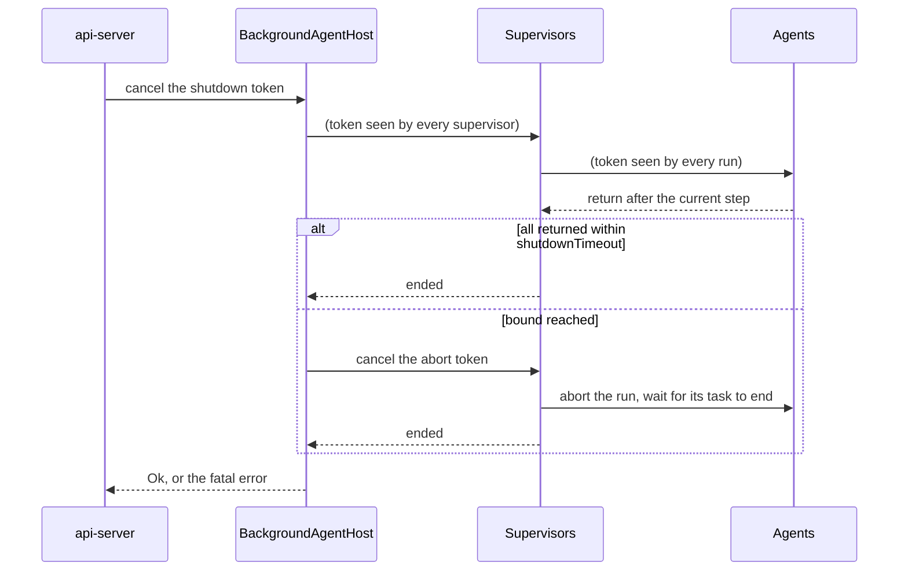

# Background Agents — Hosting

> **Status:** stable. How long-running background agents are written, supervised and shut down.
> Type names and paths below are drawn from source — when they drift, treat the source as canonical
> and update this page.

---

## Quick-start

**One-paragraph mental model.** A **background agent** is a loop that runs for the whole life of
the server: the outbox agent, the flow agent, the flow system event agent, the task agent and the
resource controller runtime. Each implements `BackgroundAgent`, and `BackgroundAgentHost` runs them
all (crate `background-agent-host`). The host supervises every agent on its own: a run that fails,
panics or returns early is restarted after a growing backoff while the other agents keep running.
On a shutdown, the host cancels a token every agent watches, gives them a bounded time to finish
their current step, then aborts the ones still running.

| You want to… | Start at |
| --- | --- |
| Write a new agent | [§1 The contract](#1-the-contract) and [§5 Recipe](#5-recipe-adding-an-agent) |
| Know what happens when an agent fails | [§3 Supervision](#3-supervision) |
| Know what a shutdown waits for | [§4 Shutdown](#4-shutdown) |
| Tune restarts or the shutdown bound | [§4 Shutdown](#4-shutdown), [wakeup-listeners.md](wakeup-listeners.md#7-configuration) |

---

## Table of contents

- [1. The contract](#1-the-contract)
- [2. Where agents run](#2-where-agents-run)
- [3. Supervision](#3-supervision)
- [4. Shutdown](#4-shutdown)
- [5. Recipe: adding an agent](#5-recipe-adding-an-agent)
- [6. Rejected approaches](#6-rejected-approaches)
- [7. File reference map](#7-file-reference-map)

---

## 1. The contract

| Part | Contract |
| --- | --- |
| `agent_name()` | A stable name: the `agent` label of the host's metrics and of `wakeup_listener_last_heartbeat_timestamp_seconds` |
| `run(&self, shutdown: CancellationToken)` | Runs until `shutdown` is cancelled, then returns `Ok`. The agent checks the token between steps and stops waiting for work when it is cancelled; it never cuts a step short itself |
| Returning `Ok` before a shutdown | An unexpected completion: the host restarts the agent |
| Returning `Err`, or panicking | A failure: the host restarts the agent, unless the failure is fatal |
| `is_failure_fatal()` | `false` by default. `true` makes any failure of the agent stop the host and every other agent |
| A new run | Starts from storage: whatever the previous run left behind (a claimed task, a half-done drain) is found again |

A **step** is the unit of work an agent never abandons on its own: a catch-up pass, a flow
activation tick, a task, a controller drain. Waits around steps are always droppable, as they only
read; `CancellationToken::run_until_cancelled` wraps them.

| Agent | Steps | Stops |
| --- | --- | --- |
| Outbox agent | the initial catch-up, then a catch-up per wakeup | while waiting for messages |
| Flow system event agent | the initial catch-up, then a catch-up per wakeup | while waiting for events |
| Flow agent | activating the due flows | while waiting for the next activation moment |
| Task agent | taking a task, and running it | while waiting for a task; never between taking and running one |
| Resource controller runtime | each controller loop's drain | after each loop's drain, in its wait; a loop that fails then is not restarted |

For example, the task agent requeues tasks left `Running` on every run
([task-system.md](task-system.md#startup-recovery)).

---

## 2. Where agents run

| Process | Agents |
| --- | --- |
| `kamu system api-server` | all of them, on `BackgroundAgentHost` (`src/app/cli/src/explore/api_server.rs`) |
| `kamu ui` | none: flows, tasks and resource controllers do not run there |
| One-shot CLI commands | none: the outbox messages and resource controller work a command causes are drained before it exits (`BackgroundWorkFinalizer`, [resources-framework.md](resources-framework.md#controller-runtime)) |

Nothing is drained after the API server stops (`command_needs_outbox_processing` excludes it), so
a shutdown stays within its bound; the next start picks up what is left.

Agents run in the background catalog, as `Principal::Node` ([identity.md](identity.md)).

---

## 3. Supervision

`BackgroundAgentSupervisor` runs each agent in a task of its own, so a panic ends that run and not
the host.

| Run ended | Logged | Then |
| --- | --- | --- |
| `Ok` after a shutdown | info, "stopped" | the supervisor ends |
| `Ok` before a shutdown | warning | restart, `reason="completed"` |
| `Err` | error, with the error | restart, `reason="failed"`; a fatal agent stops the host instead |
| Panic | error, with the panic text | restart, `reason="panicked"`; a fatal agent stops the host instead |

The delay before a restart is `backgroundAgents.restartBackoff.delay(n)` for the `n`-th consecutive
restart ([defaults](wakeup-listeners.md#7-configuration)). A run that lasted at least `maxDelay` counts as
healthy and resets `n` to 1. A shutdown cuts a restart delay short.

**Metrics** ([metrics.md](metrics.md#background-agent-host)): whether each agent is running,
restarts by reason, and the time of its last failure.

---

## 4. Shutdown

`api-server` cancels one token on Ctrl+C, on SIGTERM, on the e2e `/e2e/shutdown` route, when its
HTTP server ends unexpectedly, or when an agent fails fatally. The same token stops the HTTP server
from accepting requests and every agent.

- Agents and in-flight requests share `backgroundAgents.shutdownTimeout` ([default](wakeup-listeners.md#7-configuration)). For
  requests it bounds graceful draining: connections still open when it expires are cancelled as
  the process exits.
- The host returns only once every supervisor and every agent's own task has ended. Tasks an
  agent spawned itself (controller loops, outbox consumers) are only asked to abort; they end
  with the process, which exits right after.
- The host collects every supervisor's result, aborted or not, so a fatal error is returned even
  when the bound is reached at once.
- An aborted step leaves storage as a crash would; the next start recovers it like any other
  interrupted work.

---

## 5. Recipe: adding an agent

1. Implement `BackgroundAgent` on a `#[scope(Singleton)]` component bound as
   `dyn BackgroundAgent`. Resolve repositories per call through `CatalogWeakRef` (`kamu-dill-di`,
   "Singletons must not depend on repositories").
2. In `run`, create the agent's wakeup listener once, before the loop
   ([wakeup-listeners.md](wakeup-listeners.md)), then loop: one step, then a wait that a shutdown
   ends, returning `Ok` when it yields `None`. A plain wakeup wait is
   `WakeupListener::wait_wake_until_shutdown`; a wait combined with a deadline goes inside
   `shutdown.run_until_cancelled(...)`.
3. Make each step safe to repeat after an abort or a crash: keep its state in storage and commit
   it in short transactions.
4. Return `Err` for failures a restart may fix. Override `is_failure_fatal()` only when running on
   without the agent is worse than stopping the server.
5. Register the component in `app.rs`; the host picks it up from the catalog.
6. Test that `run` returns `Ok` once the token is cancelled while the agent waits, and that a step in
   progress finishes first.

---

## 6. Rejected approaches

| Approach | Why it was rejected |
| --- | --- |
| Stopping the server when any agent fails, panics or returns | One faulty agent took every other agent and the API down with it |
| Dropping the supervisors after the shutdown bound | Dropping a task set only requests abortion: the host could return while agent tasks still held transactions, and an aborted agent's running gauge stayed at 1 |
| Waiting for the agents and the bound in one unbiased `select!` | With a bound already due, the timeout branch could win before a fatal supervisor's error was collected, and the host returned `Ok` |
| Restarting the task agent without recovering on each run | A task taken by a failed run stayed `Running` until the next process start |
| The trait in `async-utils` and the host in a crate of its own | Splits one concept across crates; the host's dependencies (prometheus, dill, time source) do not belong in `async-utils` either |

---

## 7. File reference map

| What | File |
| --- | --- |
| `BackgroundAgent`, `CancellationToken` | `src/utils/background-agent-host/src/background_agent.rs` |
| `BackgroundAgentHost` | `src/utils/background-agent-host/src/background_agent_host.rs` |
| `BackgroundAgentSupervisor` | `src/utils/background-agent-host/src/background_agent_supervisor.rs` |
| `BackgroundAgentHostConfig` | `src/utils/background-agent-host/src/background_agent_host_config.rs`, mapped from `backgroundAgents` in `src/app/cli/src/services/config/models.rs` |
| `BackgroundAgentHostMetrics`, `BackgroundAgentRestartReason` | `src/utils/background-agent-host/src/background_agent_host_metrics.rs`, `background_agent_restart_reason.rs` |
| Shutdown sources, HTTP server bound | `src/app/cli/src/explore/api_server.rs` |
| Host tests | `src/utils/background-agent-host/tests/tests/test_background_agent_host.rs` |
