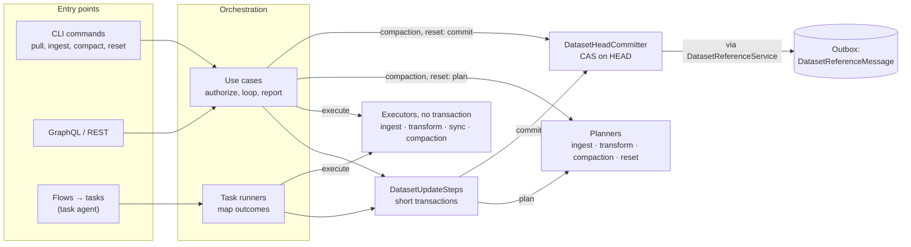
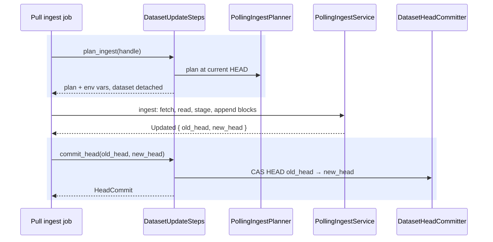
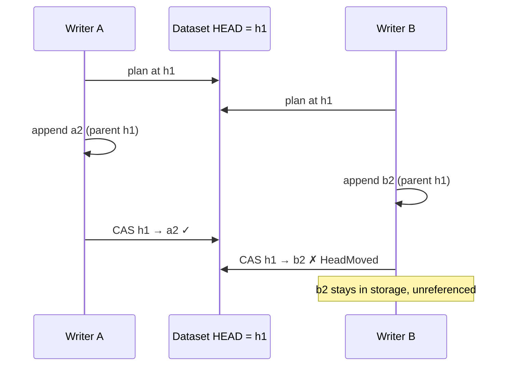

# Dataset Operations — Shared Shape

Every operation that changes a local dataset — ingest, transform, sync, compaction, reset — follows
one shape: plan in a short transaction, do the heavy work with no transaction open, then publish
the result by moving `HEAD` with a compare-and-swap. This page owns that shape. Each operation's own
page describes only what is specific to it:

| Operation | Page |
| --- | --- |
| Pull: choosing and ordering the operations for many datasets | [dataset-pull.md](dataset-pull.md) |
| Ingest into a root dataset | [root-dataset-ingest.md](root-dataset-ingest.md) |
| Transform of a derivative | [derived-dataset-transform.md](derived-dataset-transform.md) |
| Sync from or to a remote | [dataset-sync.md](dataset-sync.md) |
| Hard compaction | [dataset-hard-compaction.md](dataset-hard-compaction.md) |
| Reset to a block, reset to metadata | [dataset-reset.md](dataset-reset.md) |

---

## At a glance

- **Blocks first, `HEAD` last.** An operation appends its blocks and data files without moving
  `HEAD`. Until `HEAD` moves, no reader sees them.
- **One way to move `HEAD`.** `DatasetHeadCommitter::commit_head` moves it from an expected head to
  a new one inside the caller's transaction, and fails when another writer moved it first. There is
  no unconditional move.
- **No transaction around slow work.** Fetching, engines and transfers run for minutes; they run
  between two short transactions, never inside one.
- **A lost race leaves garbage, not corruption.** The loser's blocks stay in storage unreferenced;
  the chain `HEAD` points at is never mixed.
- **The same steps for the CLI and the server.** `kamu pull` and the update task call the same
  `DatasetUpdateSteps`; they differ in who drives them and as whom they run.

---

## 1. Components

- **Use cases** (`PullDatasetUseCase`, `CompactDatasetUseCase`, `ResetDatasetUseCase`,
  `PushIngestDataUseCase`, …) are the entry points of the CLI and the API. They authorize the
  caller through `DatasetOperationGuard` and report per-dataset results.
- **Task runners** do the same work for flows. They run as `Principal::Node`; access was checked
  when the flow was configured or triggered ([§5](#5-who-runs-it)).
- **`DatasetUpdateSteps`** holds the transactional steps of updating one dataset: plan an ingest,
  elaborate a transform, read a sync target, commit a head, transfer and commit a sync. Each step
  re-resolves the dataset by its handle in a transaction of its own and returns what it read
  detached from it.

---

## 2. Plan, execute, commit

Sequence diagrams in these pages shade a database transaction; a call outside a shaded box holds
no transaction. An ingest iteration of `kamu pull`:

| Step | Transaction | Reads or writes |
| --- | --- | --- |
| **Plan** | a short one | reads metadata at the current `HEAD`; the result names that head as the expected one |
| **Execute** | none; the datasets are detached | writes data files, checkpoints and blocks chained onto the expected head, with `update_block_ref: false` |
| **Commit** | a new short one | moves `HEAD` from the expected head to the last new block |

A dataset detached from its transaction can still be read, but moving its `HEAD` panics, so every
commit re-resolves the dataset first.

How each operation fills in the steps:

| Operation | Plan | Execute (writes blocks) | Commit |
| --- | --- | --- | --- |
| Polling ingest | `plan_ingest` | `PollingIngestService::ingest`, one iteration | `commit_head` |
| Transform | `elaborate_transform` | `TransformExecutor` | `commit_head` |
| Sync into a local dataset | `resolve_sync_target` reads the head | `SyncService::transfer_into_local` | `transfer_and_commit_sync` through `LocalSyncCommitter`, which also creates a new dataset |
| Hard compaction, reset to metadata | `CompactionPlanner`, in a short transaction of the use case or of the task planner | `CompactionExecutor` | the use case through `DatasetHeadCommitter`; the task runner through `commit_head` |
| Reset to a block | `ResetPlanner` | — (the block already exists) | `ResetExecutor`, in the same transaction as the plan |
| Push ingest | `PushIngestPlanner` | the push ingest executor | in the same transaction as the plan: the request's or the command's |

Reset and push ingest run in one transaction from plan to commit. The task-side view of the same
table, with the outcome of each commit, is in [task-system.md](task-system.md#who-moves-head).

---

## 3. Committing `HEAD`

`DatasetHeadCommitter::commit_head(target, expected_head, new_head)` is the single way to move a
dataset's `HEAD`; the `reference_writes` lint in `kamu-repo-tools` rejects direct reference writes
elsewhere. It runs in the caller's transaction, and:

- fails with `CASFailed` when `HEAD` no longer points at `expected_head`, committing nothing;
- fails with `BlockNotFound` when `new_head` is not in the dataset's block store;
- with `expected_head = None`, requires the dataset to have no `HEAD` yet.

On a database-backed dataset the move goes through `DatasetReferenceServiceImpl::set_reference`,
which writes the reference row and posts `DatasetReferenceMessage::Updated` in the same
transaction. Its consumers write the storage-level reference, index the new blocks (which feeds the
dependency graph), and update statistics and search ([outbox.md](outbox.md)). Push ingest and the
smart push server also post `DatasetExternallyChangedMessage`, which flows use to tell user pushes
from their own updates.

`DatasetUpdateSteps::commit_head` returns the outcome as a `HeadCommit`:

| `HeadCommit` | Meaning | `kamu pull` reports | A task ends |
| --- | --- | --- | --- |
| `Committed` | `HEAD` moved | the job's result | with its result |
| `HeadMoved` | another writer moved `HEAD` since planning | `PullError::HeadMoved` | failed, recoverable |
| `DatasetDeleted` | the dataset is gone | `NotFound` | failed, unrecoverable |
| `NotAllowed` | the principal may not move `HEAD` | `Access` | failed, unrecoverable |

The pull mapping is owned by [dataset-pull.md](dataset-pull.md#62-per-job-runners), the task
mapping by [task-system.md](task-system.md#who-moves-head).

---

## 4. Concurrency

No operation takes a lock. Two writers on one dataset both chain their blocks onto the head they
planned at; the first commit wins, and the second fails its CAS.

Consequences shared by every operation:

- **Readers see one operation's blocks together.** `HEAD` moves once, after all of them.
- **A crash before the commit is harmless.** A retry plans again from the current `HEAD`; the
  blocks of the failed attempt are never referenced. Neither `kamu verify` nor `kamu system gc`
  removes them.
- **Only the dataset being written is protected.** Inputs of a transform are read without locks:
  an input that moves after planning is picked up by the next run.
- **Nothing retries in-process.** A lost race is reported; the flow's retry policy runs a new task
  ([task-system.md](task-system.md#8-failure-handling)).

---

## 5. Who runs it

| Entry point | Principal | Where access is checked |
| --- | --- | --- |
| CLI command, GraphQL mutation, REST request | the caller | in the use case, through `DatasetOperationGuard`, per operation and dataset |
| Task run by a flow | `Principal::Node` | when the flow is configured or triggered, by the GraphQL mutations ([flow-system.md](flow-system.md#12-graphql-api)) |

Why background work runs as the node, and how its catalog is built, is owned by
[identity.md](identity.md#background-work-runs-as-the-node). The permission each operation needs is
in its page's authorization or entry-point section.

---

## Glossary

| Term | Meaning |
| --- | --- |
| Expected head | The `HEAD` an operation planned at; its commit succeeds only while `HEAD` still points there |
| CAS | Compare-and-swap: move `HEAD` only if it still equals the expected head |
| Detached | A dataset handle released from the transaction it was resolved in, so slow work can read it with no transaction open |
| Iteration | One ingest run of a polling source; a source with more data reports `has_more` ([root-dataset-ingest.md](root-dataset-ingest.md#54-iterating-has_more)) |
| Depth | A pull's ordering level: sources first, each derivative one deeper than its deepest input ([dataset-pull.md](dataset-pull.md#5-planning)) |
| Elaborate | Turn a transform plan into a concrete request: which input slices and watermarks to consume ([derived-dataset-transform.md](derived-dataset-transform.md#42-elaborate)) |
| Savepoint | A fetch result kept on the local disk, so a retry on the same node skips the download ([root-dataset-ingest.md](root-dataset-ingest.md#53-savepoints)) |
| History rewrite | A reset, compaction or forced sync that leaves `HEAD` on a block that is not a descendant of the old one ([dataset-reset.md](dataset-reset.md#7-after-a-history-rewrite)) |
