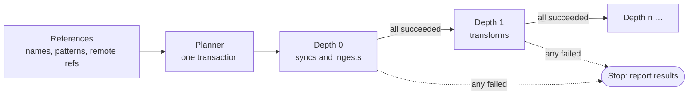
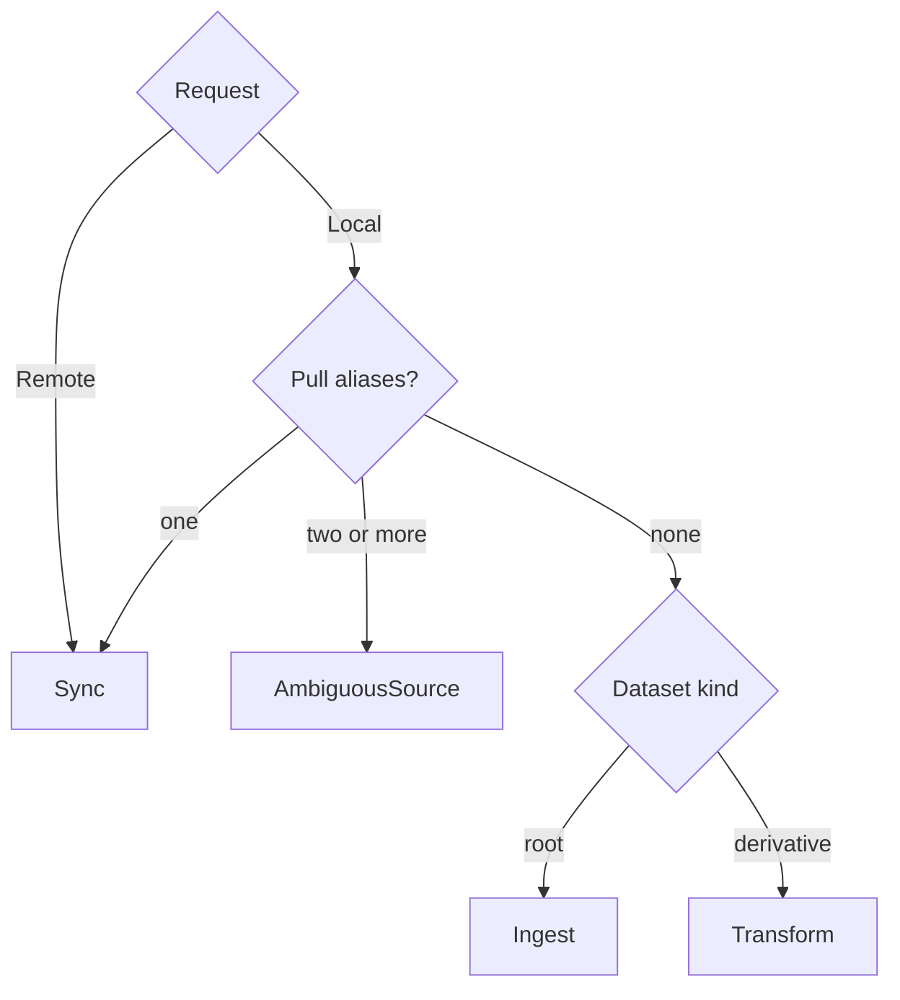
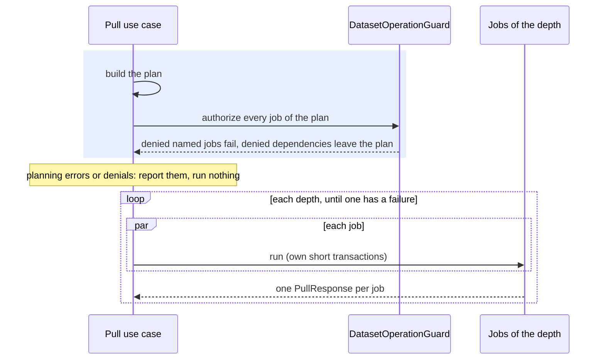

# Dataset Pull — Architecture

> **Status:** in production; covers `kamu pull` and the pull planner that the server's update task
> shares. Behaviour that surprises newcomers is listed in [§10](#10-testing--gotchas).
> Type names and paths below are drawn from source — when they drift, treat the source as canonical
> and update this page.

---

## Agent / newcomer quick-start

**At a glance.** "Pull" means *bring these datasets up to date*, whatever that takes for each:

- A dataset with a remote **pull alias** is **synced** from that remote, a root is **ingested** from
  its polling source, a derivative is **transformed** from its inputs.
- Pull itself does none of this work: it plans and schedules. The **planner** resolves the
  references, optionally walks upstream dependencies, and gives every dataset a **depth** (sources
  first, each derivative one deeper than its deepest input).
- The **use case** authorizes the whole plan before running anything, then runs one depth at a
  time: its jobs run concurrently, and the pull stops after the first depth that has an error.
- Every job follows the shared plan, execute, commit shape
  ([dataset-operations.md](dataset-operations.md)).
- The server's update task uses the same planner for one dataset and runs the single job it gets.

**Where to start reading, by intent:**

| You want to… | Start at |
| --- | --- |
| Know what `kamu pull` flags do | [§4 The CLI command](#4-the-cli-command) |
| Understand how references become a plan | [§5 Planning](#5-planning) |
| See how a plan runs | [§6 Execution](#6-execution) |
| Know who may pull what | [§7 Authorization](#7-authorization) |
| See how the server reuses pull | [§8 Server use](#8-server-use) |
| Find the file for X | [§11 Reference map](#11-filecrate-reference-map) |

---

## 1. Purpose & scope

This page covers how a pull request becomes a plan and how the plan runs: reference resolution,
dependency traversal, depth ordering, job selection, authorization, transactions, concurrency,
`HEAD` updates and result reporting.

Out of scope, each with its own owner:

| Topic | Owner |
| --- | --- |
| What an `Ingest` job does: fetch, prepare, `has_more` | [polling-ingest.md](polling-ingest.md) |
| How ingested records are read, merged and written | [ingest-data-writer.md](ingest-data-writer.md) |
| What a `Transform` job does: elaboration, engines, commit, diverged inputs | [derived-dataset-transform.md](derived-dataset-transform.md) |
| What a `Sync` job does: `SyncService`, transfer protocols, remote aliases and repositories | [dataset-sync.md](dataset-sync.md) |
| How the update task is queued, planned and run | [task-system.md](task-system.md) |
| When the server updates a dataset: flows, sensors, triggers | [flow-system.md](flow-system.md) |

---

## 2. Concepts

| Term | Meaning |
| --- | --- |
| `PullRequest` | one thing to pull: `Local(DatasetRef)` or `Remote { remote_ref, maybe_local_alias }` |
| Pull alias | a `RemoteAliasKind::Pull` remote alias of a dataset ([dataset-sync.md](dataset-sync.md#9-remote-repositories-and-aliases)); it makes the dataset a sync target on every pull |
| Depth | the dataset's position in dependency order. Sync targets and roots are depth 0; a derivative is one deeper than its deepest input |
| Plan iteration | `PullPlanIteration { depth, jobs }`: every job at one depth. Jobs within an iteration are independent |
| Job | `PullPlanIterationJob`: `Ingest(PullIngestItem)`, `Transform(PullTransformItem)` or `Sync(PullSyncItem)`, each carrying what its service needs to start |
| Explicit vs implicit item | an item the caller asked for carries its `maybe_original_request`; an upstream added by `--recursive` does not |

---

## 3. Layers and crates

| Layer | Crate / path | Contents |
| --- | --- | --- |
| Domain types | `kamu-core` — [`pull_request_planner.rs`](../../src/domain/core/src/services/pull_request_planner.rs) | `PullRequestPlanner`, `PullRequest`, `PullOptions`, plan and job types, `PullResponse`, `PullResult`, `PullError`, listeners |
| Use case trait | `kamu-core` — [`pull_dataset_use_case.rs`](../../src/domain/core/src/use_cases/pull_dataset_use_case.rs) | `PullDatasetUseCase::{execute, execute_multi, execute_all_owned}` |
| Update kind | `kamu-core` — [`dataset_update_kind_resolver.rs`](../../src/domain/core/src/services/dataset_update_kind_resolver.rs); `kamu` — [`dataset_update_kind_resolver_impl.rs`](../../src/infra/core/src/services/dataset_update_kind_resolver_impl.rs) | `DatasetUpdateKindResolver`: how one local dataset is updated (ingest, transform or sync); used only by the planner |
| Pull source | `kamu-core` — [`dataset_pull_source_resolver.rs`](../../src/domain/core/src/services/dataset_pull_source_resolver.rs); `kamu` — [`dataset_pull_source_resolver_impl.rs`](../../src/infra/core/src/services/remote/dataset_pull_source_resolver_impl.rs) | `DatasetPullSourceResolver`: a dataset's pull alias and its URL, and the inverse lookup ([dataset-sync.md](dataset-sync.md#9-remote-repositories-and-aliases)) |
| Planner | `kamu` — [`pull_request_planner/`](../../src/infra/core/src/services/pull_request_planner) | `PullRequestPlannerImpl`, `PullGraphDepthFirstTraversal`, `PullTargetResolver` |
| Operation jobs | `kamu-core` — [`dataset_jobs/`](../../src/domain/core/src/dataset_jobs); `kamu` — [`dataset_jobs/`](../../src/infra/core/src/dataset_jobs) | `PollingIngestJob`, `TransformJob`, `SyncFromJob`, `CompactionJob`: one operation on one dataset, shared with the update task ([dataset-operations.md](dataset-operations.md#1-components)) |
| Use case | `kamu` — [`src/infra/core/src/use_cases/`](../../src/infra/core/src/use_cases) | `PullDatasetUseCaseImpl`: plan authorization and iteration loop; `PullIngestLoop`, `PullTransformJob` and `PullSyncJob` run the operation jobs and add the pull's own policies |
| CLI | `kamu-cli` — [`pull_command.rs`](../../src/app/cli/src/commands/pull_command.rs) | `PullCommand`, progress listeners, result summary |
| Server | `kamu-adapter-task-dataset` | `UpdateDatasetTaskPlanner` calls the planner; `UpdateDatasetTaskRunner` runs the job ([task-system.md](task-system.md)) |

---

## 4. The CLI command

`kamu pull` is dispatched in [`cli_commands.rs`](../../src/app/cli/src/cli_commands.rs): with
`--set-watermark` it becomes `SetWatermarkCommand` and nothing below applies; otherwise it builds
`PullCommand`. `PullCommand` runs without an outer transaction (the use case and its jobs open
their own short ones), and the CLI processes outbox messages after it ([§9](#9-results-and-errors)).

| Flag | Effect |
| --- | --- |
| `<dataset>…` | local or remote references, or wildcard patterns |
| `--all` | every dataset owned by the current account (`execute_all_owned`); cannot be combined with references or `--recursive` |
| `--recursive` | also pull every transitive upstream dependency |
| `--as <name>` | exactly one remote reference, synced into a local dataset with this name (`PullRequest::Remote` with a local alias); only `--force`, `--visibility` and `--no-alias` apply |
| `--fetch-uncacheable` | `PollingIngestOptions::fetch_uncacheable` |
| `--no-alias` | `add_aliases: false`: a dataset created by sync gets no pull alias |
| `--force` | `SyncOptions::force` |
| `--visibility` | visibility of datasets created by sync |
| `--reset-derivatives-on-diverged-input` | `TransformOptions::reset_derivatives_on_diverged_input` ([derived-dataset-transform.md](derived-dataset-transform.md#7-diverged-inputs)) |

Patterns are expanded by `filter_datasets_by_any_pattern`, over local datasets or, through
`SearchServiceRemote`, remote repositories; each result becomes a `PullRequest`
(`PullRequest::from_any_ref`). The command always sets `PullOptions::exhaust_sources`, so a polling
source is ingested until it has no more data ([§6.2](#62-per-job-runners)).

Reference interpretation depends on tenancy: in a single-tenant workspace a repo-like reference
(`repo/name`) is a remote repository; in a multi-tenant workspace it is `account/name`, and
repositories need an explicit URL form.

On a TTY at default verbosity, `PrettyPullProgress` shows per-dataset progress bars. Afterwards
the command prints how many datasets were updated and up to date, and returns a `BatchError`
listing each failure. A missing Read permission is shown as "not found" (`sanitize_pull_error`),
so the CLI does not reveal that a dataset exists; other access errors, such as a missing Write on a
dataset the account can read, are shown as they are.

---

## 5. Planning

`PullRequestPlannerImpl::build_pull_multi_plan(requests, options, tenancy)` runs in one
transaction (a `transaction!` block in `PullDatasetUseCaseImpl::execute_multi`, or in
`execute_all_owned` for `--all`); its items keep dataset handles only, which later transactions
resolve again. Planning contacts no remote repository: a sync job's source is resolved by its
transfer, so the transaction never waits on the network.

### 5.1 Resolving each request

`PullGraphDepthFirstTraversal::traverse_pull_graph` handles one request. Steps 1–3 are
`PullTargetResolver::resolve`, which yields the request's target: the existing dataset of a `Local`
request, or for a `Remote` one an existing dataset or the alias to create one under.

1. **Local handle.** A `Local` ref must resolve, or the result is `NotFound`. A `Remote` request
   first tries its local alias, then searches for a local dataset whose pull aliases contain the
   remote ref (`DatasetPullSourceResolver::find_dataset_by_pull_alias`,
   [dataset-sync.md](dataset-sync.md#9-remote-repositories-and-aliases)), among the current
   account's datasets only. A dataset found this way must match any alias the caller gave, or the
   result is `SaveUnderDifferentAlias`.
2. **Missing target.** With no local dataset and `create_if_not_exists` off, the request fails
   with `AutoCreateDisabled`.
3. **Local alias.** The existing alias, the caller's alias, or one inferred from the remote ref:
   its dataset name, or for a URL the last path segment, then the host name. A ref none of these
   apply to, such as a remote ref by ID, fails with `CannotInferLocalName`.
4. **Kind.** A `Remote` request is a sync from its remote ref, whether its target exists or is
   still to be created. The target of a `Local` request gets its kind from
   `DatasetUpdateKindResolver`: its pull alias (`DatasetPullSourceResolver::find_pull_alias`) makes
   it a sync, otherwise a root is ingested and a derivative transformed. Two or more pull aliases
   fail with `AmbiguousSource`.
5. **Depth.** Syncs and ingests are depth 0. A transform is one more than its deepest upstream
   dependency (`DependencyGraphService::get_upstream_dependencies`, visited recursively).

How step 4 picks the job:

Items are keyed by local alias, so a dataset reached twice is planned once; if a later visit is
explicit, the item becomes explicit.

### 5.2 Single dataset vs graph

| Case | Traversal | Depth |
| --- | --- | --- |
| One request, not `--recursive` (also every server update task) | `build_single_node_pull_graph`: upstreams are not visited | root 0, derivative 1, sync target 0 |
| Two or more requests, or `--recursive` | `collect_pull_graph`: upstreams are visited for every request | from the graph |

`--all` takes the single-node path when the account owns exactly one dataset. Without `--recursive`, the visited upstreams are dropped afterwards (only explicit items are
kept), but the depths computed from them stay, so the requested datasets still run in dependency
order. Before traversing, `collect_pull_graph` resolves every request to its local dataset, so an
upstream that is also requested is planned from its request (for example a sync from the remote
named), whatever the order of requests. An upstream that cannot be planned (an ambiguous pull
alias, a missing dataset) is skipped without `--recursive` and adds no depth; with `--recursive`
it fails the request that reached it.

### 5.3 Turning items into jobs

Items are sorted by depth, then sync targets before local ones, then by alias, and sliced into one
iteration per depth. The job follows the item's kind:

| Item | Job | Built by | Holds |
| --- | --- | --- | --- |
| ingest | `Ingest(PullIngestItem)` | `build_pull_multi_plan`, inline | target; the ingest itself is planned when the job runs |
| sync | `Sync(PullSyncItem)` | `build_pull_multi_plan`, inline | local target (existing or to create) and remote ref; `HEAD` and the source are read when the job runs ([dataset-sync.md](dataset-sync.md#4-sync-requests)) |
| transform | `Transform(PullTransformItem)` | `build_transform_item` → `TransformPlanner::describe_transform`, which fails a broken transform before any job runs | target and the handles of its inputs; the transform itself is elaborated when the job runs |

A dataset with a pull alias is always synced, whatever its kind: a derivative pulled from a
remote is copied, never transformed locally.

If any request fails to resolve, or any item fails to become a job, `execute_multi` returns only
those errors and runs nothing. A sync source that is unknown or cannot be reached is not a planning
error: it fails only its own job.

### 5.4 Example

`kamu pull --recursive report`, where `report` is a derivative of the root `orders` and of `rates`,
a dataset with a pull alias:

| Depth | Job | Why |
| --- | --- | --- |
| 0 | `Sync(rates)` | it has a pull alias; syncs sort before local jobs |
| 0 | `Ingest(orders)` | a root; added by `--recursive` as an implicit item |
| 1 | `Transform(report)` | one deeper than its deepest input |

`rates` and `orders` run concurrently. If the remote of `rates` is unreachable, its job fails, the
`orders` ingest still commits, and the pull stops after depth 0: `report` is not attempted and the
command reports one failure and one update. Without `--recursive`, the plan holds only
`Transform(report)` at depth 1, and its inputs are used as they are.

---

## 6. Execution

### 6.1 The iteration loop

`PullDatasetUseCaseImpl::pull_by_plan` runs the iterations of an authorized plan in depth order:

- Authorization covers the whole plan, in the transaction that builds it ([§7](#7-authorization)).
- Jobs of one depth run concurrently on a `JoinSet` and independently: one job's failure does not
  cancel the others.
- If any job failed, the pull stops after this depth, since later depths may depend on it.

### 6.2 Per-job runners

Each job plans when it runs, not when the pull was planned, so it sees what earlier depths
committed. It runs the operation jobs the update task also runs, which authorize, plan, execute and
commit `HEAD` ([dataset-operations.md](dataset-operations.md#2-plan-execute-commit)).

**Ingest** (`PullIngestLoop::run`):

- runs `PollingIngestJob` once per iteration until the source reports no more data
  (`exhaust_sources`); each iteration plans and resolves the dataset's environment variables in one
  transaction ([polling-ingest.md](polling-ingest.md#4-call-sequence)) and commits `HEAD` when it
  returns `Updated`. The writer state an iteration ends with is handed to the next one, so later
  iterations do not scan the metadata again;
- reports one result spanning the first old head to the last new head. A dataset without a polling
  source is up to date;
- a failure after earlier iterations committed is `PullError::IngestStopped`, which carries the
  committed heads and increment and the failing iteration's error.

**Transform** (`PullTransformJob::run`):

- runs `TransformJob`, which elaborates in one transaction
  ([derived-dataset-transform.md](derived-dataset-transform.md#44-transactions)), executes and
  commits `HEAD`;
- on a diverged input with `--reset-derivatives-on-diverged-input`, resets the derivative to
  metadata with `CompactionJob` and runs `TransformJob` once more
  ([derived-dataset-transform.md](derived-dataset-transform.md#7-diverged-inputs));
- a failure after the reset committed is `PullError::TransformStopped`, which carries the reset's
  heads and the error.

**Sync** (`PullSyncJob::run`):

- runs `SyncFromJob`, which reads the target's `HEAD` in a transaction of its own, transfers with
  no transaction open, then moves `HEAD` or creates the new dataset in a transaction of its own;
- with `add_aliases` on, then stores the pull alias of a dataset the sync created, in a transaction
  of its own (`PullSyncJob::store_pull_alias`). Aliases live in the dataset's `info` storage, not
  in the database, so no transaction makes them atomic with the commit; a failure to store one
  fails the pull of that dataset with `SyncError::Internal` and leaves the dataset without it.
  Only `kamu pull` sets the option: the update task never records an alias.

**How a commit that did not happen is reported.** Each runner maps its job's error for
[a commit that did not happen](dataset-operations.md#3-committing-head) into that dataset's error:

| Commit | `PullError` |
| --- | --- |
| `HEAD` moved by another writer | `RefMoved`, with the expected and actual heads; a sync's `SyncError::RefMoved` becomes the same |
| Dataset deleted | `NotFound`; also for a sync whose target was deleted before the commit |
| Not allowed | `Access` |

When the same job committed earlier (an ingest iteration, or a reset before a transform), that error
becomes the `source` of `IngestStopped` or `TransformStopped`.

### 6.3 Listeners

`PullMultiListener` hands out one ingest, transform or sync listener per dataset.
`PullDatasetUseCase::execute` wraps a single-dataset `PullListener` in `ListenerMultiAdapter`.
Listeners only report progress; they cannot change the outcome.

Every pull and push activity follows one rule: the operation reports `begin` and progress, and the
caller that commits reports how the job ended, once, after its commit. A lost CAS reaches the
listener as an error, never as a success. Every failure of the job reaches it, including those
before the operation starts, which end the progress without a `begin`: ingest planning, elaboration,
authorizing inputs the plan did not cover, a reset on a diverged input, a dataset deleted since
planning.

| Activity | `begin` and progress | Ending reported by | Error passed |
| --- | --- | --- | --- |
| Pull ingest | `PollingIngestService::ingest`, per iteration | `PullIngestLoop`: `success` after each committed iteration, then `error`, or `no_polling_source` instead of both | `PullError` |
| Pull transform | `TransformExecutor` | `PullTransformJob` | `PullError` |
| Pull sync | `SyncService::sync_from` | `PullSyncJob` | `SyncError` |
| Push | `SyncService::sync_to` | `PushDatasetUseCaseImpl` | `SyncError` |
| Push ingest | `PushIngestExecutor` | `PushIngestDataUseCaseImpl`, after moving `HEAD` | `PushIngestDataError` |

The sync listener takes `SyncError` because pull and push share it.

---

## 7. Authorization

`PullAuthorization::authorize` checks the whole plan, in the transaction that builds it: each job
becomes an operation on its target (`PullPlanIterationJob::as_operation_request`), and one
[`DatasetOperationGuard`](../../src/domain/datasets/domain/src/services/dataset_operation_guard.rs)
call checks them all for the caller's `Principal`. That guard owns which permissions each operation
needs, and reports a dataset the account cannot read as not found:

| Job | Operation | Checks |
| --- | --- | --- |
| Ingest | `PollingIngest` | Write on the target |
| Transform | `Transform { inputs }` | Write on the target, Read on every input (`PullTransformItem::input_handles`) |
| Sync into an existing dataset | `SyncFrom` | Write on the target |

A denied job reports one error, its target's before any of its inputs'. A denied job of a dataset
the caller named joins the plan's errors, in job order; like a planning error, it fails the whole
command before any job runs. A denied dependency, which `--recursive` added, leaves the plan
instead, and its dependents read its current state. A dependent still needs Read on that input, so
one the account cannot read denies the dependent too.

Every operation job checks its own operation again when it runs, as the principal of the pull.
`TransformJob` checks `Transform` with the inputs its elaboration actually read, which may differ
from the planned ones when another writer changed them meanwhile, before using any result, and
fails with `PullError::Access` if one is denied. When the elaboration fails, it checks the input
the error names (`TransformElaborateError::named_input`), so an unreadable one stays not found.
Resetting the derivative on a diverged input drops
its data, so `CompactionJob` checks `ResetToMetadata` (Maintain on the target) and the pull fails
with `PullError::Access` without resetting when it is denied.

A sync target that does not exist yet has nothing to check; creating it is governed by the sync. If
it exists by the time its job runs, `SyncFromJob` checks `SyncFrom` on it before transferring.
`--all` only plans datasets the current account owns. Planning itself resolves datasets without
access checks; nothing runs before the iteration's checks pass.

---

## 8. Server use

The server never calls `PullDatasetUseCase`: the update task builds a single-node plan with
`build_pull_plan`, which asserts exactly one job or one error, and runs that job itself
([task-system.md](task-system.md#71-update-dataset)).

| | `kamu pull` | Update task |
| --- | --- | --- |
| Datasets per run | many, by depth | one |
| Authorization | the whole plan, before any job runs ([§7](#7-authorization)) | the job checks as `Principal::Node`, which always passes; access is checked when the flow is configured or triggered |
| Polling loop | until `has_more` is false | one iteration; the flow decides whether to continue |
| Diverged-input reset | optional flag | never |
| Planning to running | immediate | separated by the task queue: planning fixes the job kind and a sync's remote ref; the job plans the rest when the task runs |
| Root dataset without a polling source | up to date | unrecoverable failure: a flow that keeps polling such a dataset is misconfigured |
| Dataset deleted before it runs | `NotFound` for that dataset | unrecoverable failure |

---

## 9. Results and errors

Each dataset produces one `PullResponse`: the original request (empty for implicit upstreams),
the local and remote refs if resolved, and `Result<PullResult, PullError>`.

`PullResult` is `UpToDate(kind)` or `Updated { old_head, new_head, has_more }`. `PullError` holds
the planning errors of [§5.1](#51-resolving-each-request), the errors of each job's own operation
(`ScanMetadata` among them, from planning an ingest when the job runs), the lost commit race of
any job (`RefMoved`), `Access` and `Internal`.

`PullError::is_recoverable()` tells whether pulling again could succeed. The errors of a job's
operation take the answer from that operation; a lost commit race and `Internal` are recoverable;
the planning errors and `Access` are not.

An `InternalError` returned by a job runner itself aborts the whole pull rather than becoming a
per-dataset error; a failure to plan an ingest, resolve its env vars or move `HEAD` is a
per-dataset error ([§6.2](#62-per-job-runners)). A job that panics re-raises the panic in the
command (`JoinSet::join_all`), aborting the other jobs of its iteration.

Any failed dataset makes the command return an error. The CLI still processes the outbox before
reporting it, so the deferred consumers of the datasets that did update run in the same command.

---

## 10. Testing & gotchas

### Testing

- Planner tests: `src/infra/core/tests/tests/test_pull_request_planner_impl.rs`.
- Use case tests: `src/infra/core/tests/tests/use_cases/` (`test_pull_dataset_use_case.rs`).
- CLI scenarios: `src/e2e/app/cli/repo-tests/src/commands/test_pull_command.rs`.

### Behaviour by design

| Area | What happens |
| --- | --- |
| Stop on error | The first depth with an error is the last one run; later depths, including datasets unrelated to the failure, are not attempted |
| Planning errors and denials | One unresolvable reference or denied job of a named dataset fails the whole command before anything runs |
| Denied dependencies | A recursive pull skips a dependency the account may not update, and pulls its dependents on its current state |
| Pull aliases | A dataset with a pull alias is synced, never ingested or transformed, even when it has a source or a transform ([`DatasetUpdateKindResolver`](#51-resolving-each-request)) |
| Non-recursive multi-pull | Upstreams are traversed for ordering only; they are not pulled |
| Hidden datasets | The CLI reports an unauthorized dataset as not found |

---

## 11. File/crate reference map

| Concern | File |
| --- | --- |
| Planner trait, requests, options, plan, results, errors | [`pull_request_planner.rs`](../../src/domain/core/src/services/pull_request_planner.rs) |
| Use case trait | [`pull_dataset_use_case.rs`](../../src/domain/core/src/use_cases/pull_dataset_use_case.rs) |
| Update kind of one dataset | [`dataset_update_kind_resolver_impl.rs`](../../src/infra/core/src/services/dataset_update_kind_resolver_impl.rs) |
| Pull source of one dataset, inverse lookup by pull alias | [`dataset_pull_source_resolver_impl.rs`](../../src/infra/core/src/services/remote/dataset_pull_source_resolver_impl.rs) |
| Planner: resolution, traversal, depths, job building | [`pull_request_planner/`](../../src/infra/core/src/services/pull_request_planner) |
| Use case: iteration loop | [`pull_dataset_use_case_impl.rs`](../../src/infra/core/src/use_cases/pull_dataset_use_case_impl.rs) |
| Authorization of a plan | [`pull_authorization.rs`](../../src/infra/core/src/use_cases/pull_authorization.rs) |
| Transform job: reset on a diverged input | [`pull_transform_job.rs`](../../src/infra/core/src/use_cases/pull_transform_job.rs) |
| Sync job | [`pull_sync_job.rs`](../../src/infra/core/src/use_cases/pull_sync_job.rs) |
| Operation jobs shared with the update task | [`dataset_jobs/`](../../src/infra/core/src/dataset_jobs) |
| Polling ingest loop of an ingest job | [`pull_ingest_loop.rs`](../../src/infra/core/src/use_cases/pull_ingest_loop.rs) |
| CLI command, progress, error display | [`pull_command.rs`](../../src/app/cli/src/commands/pull_command.rs) |
| CLI flags and dispatch | [`cli.rs`](../../src/app/cli/src/cli.rs), [`cli_commands.rs`](../../src/app/cli/src/cli_commands.rs) |
| Server update task | [`update_dataset_task_planner.rs`](../../src/adapter/task-dataset/src/planners/update_dataset_task_planner.rs), [`update_dataset_task_runner.rs`](../../src/adapter/task-dataset/src/runners/update_dataset_task_runner.rs) |
