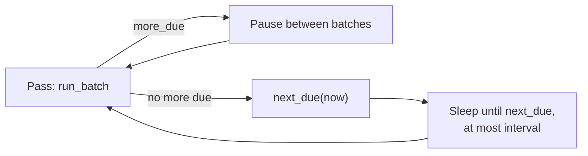

# Housekeeping Jobs

> **Status:** stable. How periodic jobs remove data nobody needs any more, on the API server and
> after CLI commands. Type names and paths below are drawn from source — when they drift, treat
> the source as canonical and update this page.

---

## Quick-start

**One-paragraph mental model.** A **housekeeping job** removes data that has outlived its use,
such as deleted resources past their retention. It implements `HousekeepingJob`: one method
removes a bounded batch of what is due, in short transactions of its own, and reports what it
removed and whether more is due; another counts what is due; a third says when the next item
falls due. The job never decides when it runs. On the API server, `BackgroundAgentHost` runs each
enabled job as an agent of its own, `HousekeepingAgent`, which runs batches while items remain
due, then sleeps until the job's next deadline, never longer than the job's interval. After a CLI
command, `BackgroundWorkFinalizer` runs one batch of each enabled job, so a workspace that never
runs `api-server` is cleaned too. Every process may run a job at once, so a batch must be
idempotent and safe next to another runner.

| You want to… | Start at |
| --- | --- |
| Add a job | [§2 The job contract](#2-the-job-contract), [§5 Rules for jobs](#5-rules-for-jobs), [§9 Recipe](#9-recipe-adding-a-job) |
| Know when a job runs | [§3 The agent](#3-the-agent), [§4 After a CLI command](#4-after-a-cli-command) |
| Tune or disable a job | [§6 Configuration](#6-configuration) |
| Watch a job | [§7 Metrics](#7-metrics) |
| Know why it is not a flow | [§11 Rejected approaches](#11-rejected-approaches) |

---

## Table of contents

- [1. Purpose and scope](#1-purpose-and-scope)
- [2. The job contract](#2-the-job-contract)
- [3. The agent](#3-the-agent)
- [4. After a CLI command](#4-after-a-cli-command)
- [5. Rules for jobs](#5-rules-for-jobs)
- [6. Configuration](#6-configuration)
- [7. Metrics](#7-metrics)
- [8. Inventory](#8-inventory)
- [9. Recipe: adding a job](#9-recipe-adding-a-job)
- [10. Tests](#10-tests)
- [11. Rejected approaches](#11-rejected-approaches)
- [12. File reference map](#12-file-reference-map)

---

## 1. Purpose and scope

Several kinds of history grow without limit unless something removes them: deleted resources,
consumed outbox messages, old events of aggregates, and task logs. Each needs the same machinery:
find what is due, remove it in bounded batches, wake up again in time, report progress, and run in
CLI workspaces as well as on the server. Housekeeping owns that machinery; each job owns only what
it removes and when that falls due.

A job only removes data that no reader needs any more. It never runs domain logic of the data it
removes: the resource retention job never calls a controller, for example.

---

## 2. The job contract

| Part | Contract |
| --- | --- |
| `job_name()` | A stable name: the agent name, the `job` label of the [metrics](#7-metrics) and the key of the job's [configuration](#6-configuration) |
| `run_batch(now, batch_size)` | Removes at most `batch_size` items due at `now`, in short transactions of its own, and returns a `HousekeepingBatchReport` |
| `count_due(now)` | The number of items due at `now`, for the backlog metric. It may scan the whole backlog, so the agent calls it at most once per pass |
| `next_due(now)` | The moment after `now` when an item next falls due, or `None` for a job without deadlines of its own |

`HousekeepingBatchReport` carries:

- `removed_by_kind`: the items the batch removed, by a kind the job defines (the resource type for
  resource retention). The kinds are a metric label: keep them few and stable.
- `more_due`: whether items were still due once the batch ended, which makes the agent run
  another batch. A batch learns it without counting, by finding one item past its size.

A job is a `#[scope(Singleton)]` component bound as `dyn HousekeepingJob`. It resolves its
repositories per call through `CatalogWeakRef`, opening its transactions with
`#[transactional_methodN]` or `transaction!`
([database-transactions.md](database-transactions.md#2-opening-a-transaction-in-code)).

---

## 3. The agent

The host builds one `HousekeepingAgent` per enabled job, next to the agents registered as
`dyn BackgroundAgent`, so each job is supervised, restarted and stopped on its own
([background-agents.md](background-agents.md#3-supervision)).



- **A pass** runs batches until a batch reports nothing more due, with `pauseBetweenBatches`
  between them. It records the time it ended as the job's heartbeat.
- **The backlog** is counted with `count_due` after the first batch of a pass that leaves items
  due, then lowered by what each later batch removes, and set to 0 when the pass ends.
- **Each batch** runs in a root span `HousekeepingAgent::run_batch` with the `job` field.
- **The sleep** lasts until the job's next deadline, but never longer than `interval`. A job
  without deadlines therefore runs once per interval. A job with deadlines learns of an earlier
  deadline within one interval, when it reads `next_due` again: no wakeup signal tells it.
- **A shutdown** stops the agent between batches and during the pause and the sleep; a batch in
  progress is never cut short by the agent.
- **A failed batch** ends the run with its error. The host restarts the agent after its backoff,
  and the new run starts with a pass, so the work is taken up from storage.

The sleeps use `SystemTimeSource`, so tests on a fake clock control them.

---

## 4. After a CLI command

A CLI command runs no agents. After its own work, `BackgroundWorkFinalizer` first settles the
background work the command caused, then runs **one batch** of each enabled job. Why the
finalizer has these two phases, and who runs which, is in
[background-agents.md](background-agents.md#2-where-agents-run).

- One batch per command keeps every command fast. A backlog, such as the first run after a long
  gap, clears over the following commands.
- If any batch removed items, the finalizer settles again, so the messages the batch posted (such
  as `Purged`) are delivered before the command exits.
- A failed batch is logged as a warning and the command still succeeds: the command's own effects
  are complete, and the next command retries the batch.

---

## 5. Rules for jobs

A job can run in several processes at once: every API server replica runs its agent, and a CLI
command may run a batch while a server runs on the same workspace database.

| Rule | Why | Resource retention does it with |
| --- | --- | --- |
| **Idempotent batches.** A batch cut short by a crash or a failed transaction loses nothing; the next batch finishes the work | Agents restart and CLI commands are killed | One transaction per batch: everything it removes commits together |
| **Concurrency-safe.** Two runners never remove an item twice, and never act on an item the other removed | Several processes run the job | A compare-and-set claim on the deadline before anything is removed. Concurrency control is optimistic only: no row locks are taken ([kamu-sqlx-database-work](../../.claude/skills/kamu-sqlx-database-work/SKILL.md#concurrent-modifications-in-event-stores)) |
| **Bounded.** A batch takes at most `batch_size` items | Short transactions do not hold up writers | `LIMIT` on the due query |
| **Leave the outbox alone.** A job never removes messages a consumer has not processed | Consumers learn outcomes from messages, not from the data the job removes | The purge does not touch the outbox |
| **Report whether more is due, cheaply.** Fetch one item past the batch rather than counting in the batch; count only in `count_due`, in a transaction of its own | The agent keeps going while items remain due; a count inside every batch would scan the backlog per batch | `LIMIT batch_size + 1` on the due query; `count_resources_due_for_purge`, on the partial index of `purge_at` |

---

## 6. Configuration

Each job has an entry under `backgroundAgents.housekeeping`, keyed by the job; the CLI maps it to
`HousekeepingConfig`, keyed by `job_name()`. A job without an entry runs with the defaults.

```yaml
backgroundAgents:
  housekeeping:
    resourceRetention:        # ResourceRetentionJob
      enabled: true
      batchSize: 100          # at most 1000; 0 is treated as 1
      interval: 5m            # greater than zero
      pauseBetweenBatches: 100ms
```

| Key | Meaning |
| --- | --- |
| `enabled` | Whether the job runs, on the server and after CLI commands |
| `batchSize` | Items removed per batch, at most 1000: a batch binds a statement parameter per item |
| `interval` | The longest sleep between two passes, greater than zero |
| `pauseBetweenBatches` | The pause between the batches of one pass, which leaves room to other writers while a backlog drains |

What a job removes and when it falls due is the job's own configuration, such as
`resources.retention` for resource retention
([resources-framework.md](resources-framework.md#retention)).

---

## 7. Metrics

The runner records the same metrics for every job, labelled by `job`: the items removed by kind,
the backlog ([§3](#3-the-agent)), and the time of the last finished pass, which serves as the
job's heartbeat. The catalog and the alerts are in [metrics.md](metrics.md#housekeeping-jobs).

---

## 8. Inventory

| Job | `job_name()` | Config key | Removes | Deadline |
| --- | --- | --- | --- | --- |
| `ResourceRetentionJob` | `dev.kamu.domain.resources.ResourceRetentionJob` | `resourceRetention` | Deleted resources past their retention, with everything keyed by them ([resources-framework.md](resources-framework.md#purge)) | The nearest `purge_at` |

The job name is the `job` metric label and the agent name: renaming it breaks dashboards and alert
rules ([kamu-renaming-a-concept](../../.claude/skills/kamu-renaming-a-concept/SKILL.md)).

---

## 9. Recipe: adding a job

1. Implement `HousekeepingJob` on a `#[scope(Singleton)]` component bound as
   `dyn HousekeepingJob`, resolving repositories per call (§2). Follow the rules of §5.
2. Give its storage the queries a batch needs: find the due items, claim them with a
   compare-and-set, remove them, count what is due, and find the next deadline if it has one.
   Test them in the shared repository suites
   ([kamu-repository-tests](../../.claude/skills/kamu-repository-tests/SKILL.md)).
3. Register the component in its domain's `register_dependencies`. The host and the finalizer
   find it in the catalog.
4. Add its entry to `BackgroundAgentsHousekeepingConfig` in
   `src/app/cli/src/services/config/models.rs`, mapped to its `job_name()`, then
   `make resources`.
5. Add a row to the [inventory](#8-inventory) and document what it removes in the doc of its
   domain.
6. Test a batch on the in-memory stack: what is due goes, what is not stays, a failed batch
   leaves everything for the next, concurrent batches remove each item once (§10).

---

## 10. Tests

| What | Where |
| --- | --- |
| The agent: bounded batches, the pause, the capped sleep, shutdown between batches, a failed batch, one agent per enabled job | `src/utils/background-agent-host/tests/tests/test_housekeeping_agent.rs` |
| The finalizer: settling until a full pass is idle, one batch per enabled job, settling again, a failing job | `src/utils/background-agent-host/tests/tests/test_background_work_finalizer.rs` |
| Test doubles | `ScriptedHousekeepingJob` in `src/utils/background-agent-host/tests/tests/utils` |
| Resource retention | [resources-framework.md](resources-framework.md#15-tests) |

---

## 11. Rejected approaches

| Approach | Why it was rejected |
| --- | --- |
| A cron flow owned by the node (`dev.kamu.flow.system.gc`) running the cleanups as tasks | Retention would depend on the flow and task systems, which run on resources themselves: a broken flow or task agent would stop the purge of `Task` resources. Every run would add a task and a flow run, history that itself needs cleaning. One-shot CLI commands run no flows, nothing sets triggers for system-scope flows, and `PurgeImmediately` would wait for the next tick. A flow could later offer a manual "run now" over the same jobs |
| Cron schedules per job | Need the flow system's `Schedule` in a shared crate and give no deadline precision; a job's own deadline, capped by an interval, covers jobs with and without deadlines |
| A wakeup source for earlier deadlines (Postgres `NOTIFY`, SQLite polling, an in-memory signal) | A third storage-specific mechanism ([wakeup-listeners.md](wakeup-listeners.md)) for at most one interval of delay |
| One agent running every job | A failing job would stall the others, and the host's per-agent restarts and metrics would no longer tell the jobs apart |
| Purging until empty after each CLI command | The first command after a long gap would stall; one batch per command clears a backlog over several commands |
| Row locks (`FOR UPDATE SKIP LOCKED`) so that concurrent purgers take disjoint batches | Concurrency control in this system is optimistic only; a compare-and-set claim makes the second purger take nothing |

---

## 12. File reference map

| What | File |
| --- | --- |
| `HousekeepingJob`, `HousekeepingBatchReport` | `src/utils/background-agent-host/src/housekeeping/housekeeping_job.rs` |
| `HousekeepingAgent` | `src/utils/background-agent-host/src/housekeeping/housekeeping_agent.rs` |
| `HousekeepingConfig`, `HousekeepingJobConfig` | `src/utils/background-agent-host/src/housekeeping/housekeeping_config.rs`, mapped from `backgroundAgents.housekeeping` in `src/app/cli/src/services/config/models.rs` |
| `HousekeepingMetrics` | `src/utils/background-agent-host/src/housekeeping/housekeeping_metrics.rs` |
| One agent per enabled job | `HousekeepingAgent::for_enabled_jobs`, called by `BackgroundAgentHost` (`background_agent_host.rs`) and the finalizer |
| `BackgroundWorkFinalizer`, `BackgroundWorkDrain` | `src/utils/background-agent-host/src/finalizer/` |
| `ResourceRetentionJob` | `src/domain/resources/services/src/retention/resource_retention_job.rs` |
