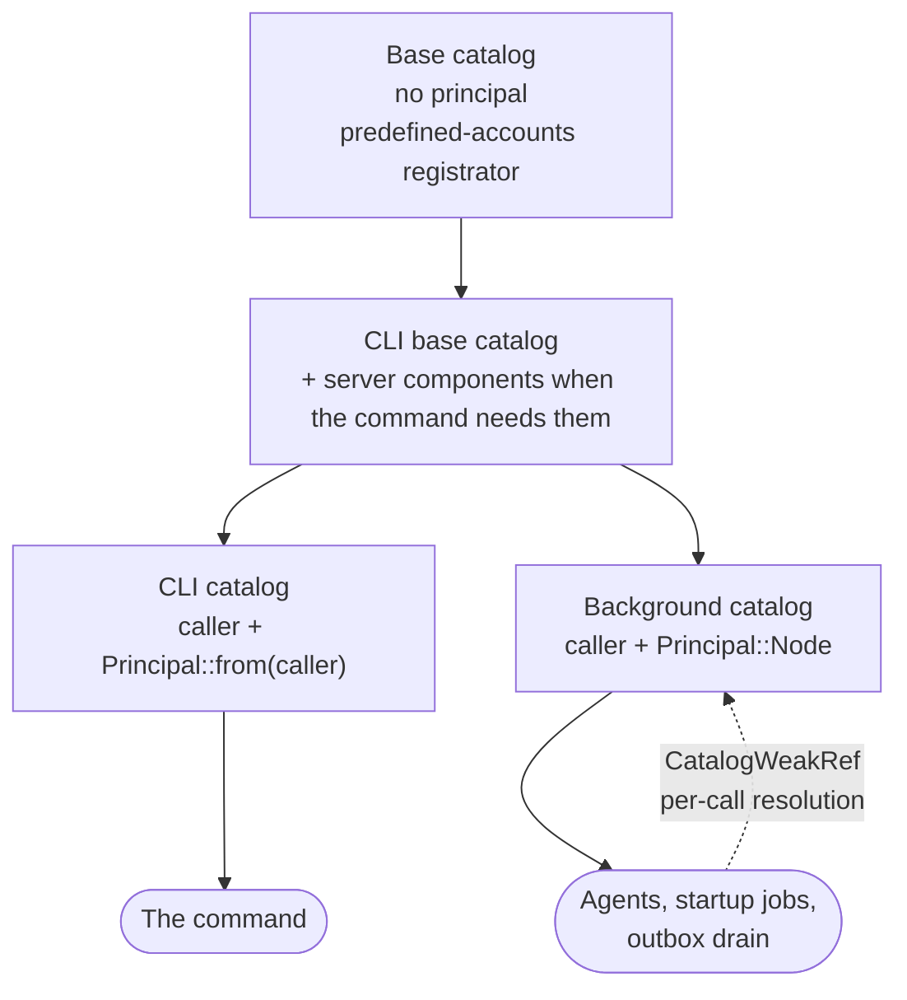

# Identity: Caller and Principal

Two values describe who is behind a piece of work, and they are not the same thing:

| Value | What it is | Read by |
|---|---|---|
| `CurrentAccountSubject` | The **caller**: whoever authenticated the request or started the command | Name scope of unqualified aliases, the account new resources are placed in, adapter guards (`LoggedInGuard`, `AdminGuard`, `CanProvisionAccountsGuard`) |
| `Principal` | The identity whose **permissions are checked** ([RFC-020, Principals](https://github.com/open-data-fabric/open-data-fabric/blob/master/rfcs/020-auth.md#principals)) | The permission layer: `DatasetPermissionChecker`, `DatasetOperationGuard`, `RebacDatasetRegistryFacade`, `AccountAuthorizationHelper`, `ResourceAccountResolver`, `QueryService`, `ProvenanceService` |

For a request or a CLI command the principal is derived from the caller. Background work keeps the
caller of the process but runs as `Principal::Node`.

## The principal

`Principal` lives in `kamu-accounts` (`src/domain/accounts/domain/src/entities/principal.rs`):

| Variant | Meaning | Permissions |
|---|---|---|
| `User(AccountHandle)` | An authenticated account of a person | Decided by Oso and ReBAC |
| `Node` | The local node, acting in system work | Passes every dataset and account check without asking Oso and counts as admin; holds no account's signing key |
| `Anonymous` | An unauthenticated request | Public datasets only |

`Principal::handle()` gives the ODF `odf::metadata::auth::PrincipalHandle`, or `None` for
`Anonymous`. The handle of `Node` has the reserved name `node`, a resource ID seeded from that
name, and no DID.

Match on `Principal` exhaustively, including in `==` and `matches!` tests: adding a variant must
fail to compile at every site that decides permissions
([`kamu-rust-style`](../../.claude/skills/kamu-rust-style/SKILL.md)).

## Who registers it

Every catalog that serves work registers exactly one `Principal`. A catalog without one fails to
resolve the permission layer's callers; there is no fallback. The one catalog that runs work without
a principal is the base catalog, on which `app::run` runs the predefined-accounts registrator before
the caller is known; that job must not reach the permission layer.

| Boundary | Registers |
|---|---|
| HTTP authentication layer, Flight SQL auth layer, the CLI catalog (`app.rs`) | The caller with `add_current_account_subject`, which adds `Principal::from(&subject)` beside it |
| Background catalog (`configure_background_catalog` in `app.rs`) | The process caller and `Principal::Node` |
| `KamuBackgroundCatalog::system_user_catalog` (search lazy init, the admin index reset) | The process caller and `Principal::Node` |
| Test harnesses | `add_current_account_subject`, or a `Principal` value directly where a mock ignores it |

Register the caller through `CurrentAccountSubjectCatalogExt::add_current_account_subject`, never
with a bare `add_value(subject)`, so the two cannot disagree.

## Who reads it

| Layer | Takes the principal |
|---|---|
| Permission services listed above | **Explicitly**, as a `&Principal` argument of every method that decides access |
| Use cases | Injected `Arc<Principal>`, passed down on each call |
| Adapters (GraphQL resolvers, HTTP handlers and middleware, OData, Flight SQL session managers) | Read from the request catalog, passed down |
| CLI commands | Injected `Arc<Principal>`, passed down |
| `LocalResourceFacadeImpl` | Injected, as the entry point of the resources subsystem |

Services take it explicitly because one service instance may decide for several principals: a
background task checks permissions for the principal it runs under, not for whoever owns the
catalog. Use cases are the entry points of one piece of work, so they are where the principal of
that work is fixed.

`QueryService` takes the principal only where it selects datasets itself (`create_session`,
`sql_statement`). Its other methods receive a `ResolvedDataset`, which the caller has already
authorized.

## Background work runs as the node

Agents, startup jobs and the outbox drain after a command resolve from the **background catalog**,
built in `app.rs`:

- It is a *sibling* of the CLI catalog: the same CLI components on the same parent, with the process
  caller and `Principal::Node` instead of the caller's principal.
- It cannot be chained from the CLI catalog: a child catalog cannot override its parent's
  `Principal` ([`kamu-dill-di`](../../.claude/skills/kamu-dill-di/SKILL.md#chaining-catalogs)).
- System singletons are resolved from it first: metrics registration, then the startup jobs, then
  the agents collected by `APIServer::new`. A singleton keeps a `CatalogWeakRef` to the catalog
  that first created it and resolves its per-call dependencies there, so its later work runs as
  `Node`.
- It lives for the whole of `app::run`. A `CatalogWeakRef` falls back to the next live catalog in
  its chain, which holds no principal.

The command itself still resolves from the CLI catalog and runs as the caller.

## Not modelled

These parts of the [RFC-020](https://github.com/open-data-fabric/open-data-fabric/blob/master/rfcs/020-auth.md) model have no counterpart in `Principal`:

- name scope and ownership, which come from the caller;
- a `ServiceAccount` variant;
- the node as an account;
- a domain layer free of the caller.

## Rejected approaches

| Approach | Why it was rejected |
|---|---|
| Deriving `Principal` from `CurrentAccountSubject` in a dill component | Background work must have a principal other than its caller; a derived value cannot differ |
| Injecting the principal into services such as `QueryService` | Fixes one principal per instance, so a shared service could not decide for another; inconsistent with the use cases being the entry points |
| Chaining the background catalog from the CLI catalog and adding `Principal::Node` | dill reports the type as ambiguous; it does not override values from a parent |
