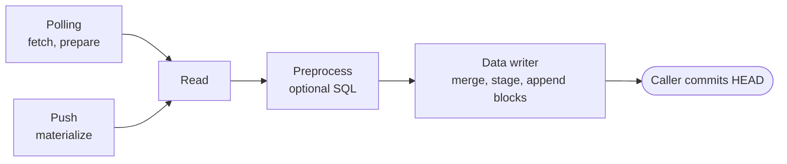

# Ingest Data Writer — Architecture

> **Status:** in production; shared by polling and push ingest into root datasets.
> Type names and paths below are drawn from source — when they drift, treat the source as canonical
> and update this page.

---

## Agent / newcomer quick-start

**At a glance.**

- A **root dataset** gets data through a **source** declared in its chain: one `SetPollingSource`
  (Kamu fetches the data, [polling-ingest.md](polling-ingest.md)) or any number of named
  `AddPushSource` events (a client sends it, [push-ingest.md](push-ingest.md)).
- Both kinds end in the same steps, owned here: read the input into a DataFusion data frame, run an
  optional preprocess query, and hand it to the **data writer**.
- The writer **merges** the data with the dataset's history by the source's merge strategy, writes
  one Parquet slice, and appends `SetDataSchema` (first time only) and `AddData` blocks — without
  moving `HEAD`. The caller commits `HEAD` afterwards
  ([dataset-operations.md](dataset-operations.md)).



**Where to start reading, by intent:**

| You want to… | Start at |
| --- | --- |
| Know the ODF concepts this builds on | [§2 ODF concepts](#2-odf-concepts) |
| Understand what gets written to the chain and data | [§5 `stage` then `commit`](#5-stage-then-commit) |
| Know how records are merged with history | [§7 Merge strategies](#7-merge-strategies) |
| Follow a polling ingest end to end | [polling-ingest.md](polling-ingest.md) |
| Follow a push ingest end to end | [push-ingest.md](push-ingest.md) |
| Find the file for X | [§11 Reference map](#11-filecrate-reference-map) |

---

## 1. Purpose & scope

Ingest is the only way new records enter the system; everything else (transform, sync) derives
from or copies records that were ingested somewhere. Polling and push ingest differ in how input
arrives and who drives them; they share the steps after it: reading, preprocessing, merging and
writing. This page covers those shared steps.

Out of scope, each with its own owner:

| Topic | Owner |
| --- | --- |
| Polling sources: fetch, prepare, savepoints, source state, `has_more` | [polling-ingest.md](polling-ingest.md) |
| Push sources: the push use case, data sources, the HTTP endpoint | [push-ingest.md](push-ingest.md) |
| Moving `HEAD` after the writer appended blocks, races | [dataset-operations.md](dataset-operations.md#3-committing-head) |
| The ODF metadata model itself | [ODF spec](https://github.com/open-data-fabric/open-data-fabric/blob/master/specs/overview.md) |
| Derivative datasets (`SetTransform`, `ExecuteTransform`) | [derived-dataset-transform.md](derived-dataset-transform.md) |

---

## 2. ODF concepts

The [Open Data Fabric specification](https://github.com/open-data-fabric/open-data-fabric) owns
the metadata events, merge strategy semantics, system columns and watermarks. This page does not
restate them; read these first:

| Topic | Spec / RFC |
| --- | --- |
| Root datasets and ingestion | [Root Dataset](https://github.com/open-data-fabric/open-data-fabric/blob/master/specs/glossary.md#root-dataset), [Data Ingestion](https://github.com/open-data-fabric/open-data-fabric/blob/master/specs/datasets/ingestion.md) |
| `SetDataSchema` | [RFC-010](https://github.com/open-data-fabric/open-data-fabric/blob/master/rfcs/010-data-schema-in-metadata.md), [RFC-016](https://github.com/open-data-fabric/open-data-fabric/blob/master/rfcs/016-odf-schema.md) |
| Offsets in `AddData` | [RFC-001](https://github.com/open-data-fabric/open-data-fabric/blob/master/rfcs/001-record-offsets.md), [RFC-014](https://github.com/open-data-fabric/open-data-fabric/blob/master/rfcs/014-minimize-offset-scanning.md) |
| Merge strategies | [Merge Strategies](https://github.com/open-data-fabric/open-data-fabric/blob/master/specs/datasets/ingestion.md#merge-strategies) |
| The `op` column, retractions and corrections | [RFC-015](https://github.com/open-data-fabric/open-data-fabric/blob/master/rfcs/015-unified-changelog-stream-schema.md) |
| Linked objects | [RFC-017](https://github.com/open-data-fabric/open-data-fabric/blob/master/rfcs/017-large-files-linking.md) |
| Watermarks | [Watermark](https://github.com/open-data-fabric/open-data-fabric/blob/master/specs/glossary.md#watermark) |

---

## 3. Layers and crates

| Layer | Crate / path | Contents |
| --- | --- | --- |
| Domain interfaces | `kamu-core` — [`src/domain/core/src/services/ingest/`](../../src/domain/core/src/services/ingest) | `DataWriter`, `MergeStrategy`, `Reader`, `DataFormatRegistry`, writer error types |
| Writer state | `kamu-core` — [`writer_metadata_state.rs`](../../src/domain/core/src/entities/writer_metadata_state.rs) | `DataWriterMetadataState`: the projection of the chain the writer needs |
| DataFusion writer | `kamu-ingest-datafusion` — [`src/infra/ingest-datafusion/`](../../src/infra/ingest-datafusion/src) | `DataWriterDataFusion`, merge strategies, readers |
| Shared ingest steps | `kamu` — [`ingest_common.rs`](../../src/infra/core/src/services/ingest/ingest_common.rs) | the session context factory, the preprocess step and the default preprocessing |

The writer and the merge strategies know nothing about where input came from; the polling and
push services know nothing about how records are merged.

---

## 4. Read and preprocess

- **Read** — the source's `ReadStep` picks a reader from `DataFormatRegistry`. An empty or missing
  input file yields an empty frame when the read step has a schema, and no frame otherwise.
- **Preprocess** — the source's `Transform` runs in DataFusion in-process or in a provisioned
  engine; without one, `preprocess_default` renames columns that clash with system columns and
  coerces an integer or string `event_time` to a timestamp, but only when the read step has no
  explicit schema.

Each kind of source decides what file reaches the reader and which read step applies: polling after
its prepare steps ([polling-ingest.md](polling-ingest.md#4-call-sequence)), push after
materializing the input and, when the caller names a media type, overriding the read step
([push-ingest.md](push-ingest.md#5-data-sources-and-formats)).

---

## 5. `stage` then `commit`

### 5.1 Writer state

`DataWriterMetadataState::build(target, block_ref, source_name, head)` walks the chain once from
`head` (or from the resolved `block_ref` when `head` is `None`) and collects what a commit needs:
the schema, the active source for `source_name` and its merge strategy, the vocabulary, the hashes
of data slices already added, and the offset, watermark, checkpoint and source state of the latest
`AddData`. Every commit is chained onto `head`.

`build` asserts the seed's kind is `Root`; callers must reject derivative datasets before calling
it. The state is built once per operation and updated in memory by each commit, so a multi-step
operation (a polling loop, a multi-source push) does not rescan the chain.

### 5.2 The two steps

`DataWriter` splits writing in two so callers can inspect the result (for example, check a storage
quota) before anything is appended:

```text
stage(df?, opts)                                   commit(staged)
 ├─ validate_input        no system columns         ├─ commit_event(SetDataSchema)   if new_schema
 ├─ normalize_raw_result  timestamps → ms, UTC      ├─ commit_add_data(AddData, data_file)
 ├─ get_all_previous_data read every past slice      │     prev_block_hash = meta.head
 ├─ ensure_event_time_column                         │     update_block_ref = false
 ├─ merge_strategy.merge(prev, new)                  └─ advance meta: head, prev_offset,
 ├─ with_system_columns   offset, system_time,             data_slices, watermark,
 │                        event_time fallback              source_state, checkpoint
 ├─ coerce_schema / validate_schema_compatible
 ├─ write_output          single Parquet file
 └─ compute_offset_and_watermark, linked objects
```

`write` is `stage` followed by `commit`. `write_watermark` commits an `AddData` that carries no data,
only a watermark and optionally a source state. Ingest does not use it; `SetWatermarkExecutorImpl`
(behind `SetWatermarkUseCase`) does, passing the previous source state on so the polling source
resumes where it was. That executor moves `HEAD` through `DatasetHeadCommitter` and fails with
`SetWatermarkExecutionError::RefCASFailed` if `HEAD` moved after planning.

The writer never moves `HEAD`. The blocks published together can be a `SetDataSchema` alone, when a
first ingest yields no rows ([§6](#6-what-stage-decides)).

---

## 6. What `stage` decides

| Situation | `SetDataSchema` | `AddData` | Result |
| --- | --- | --- | --- |
| Input produced records | yes, if the dataset has no schema yet | offsets, slice, watermark = max(prev, max `event_time`), source state | committed |
| Input was read but merge produced no records | yes, if the dataset has no schema yet | only if watermark or source state changed | committed or `EmptyCommit` |
| No data frame at all (`None`) | no | only if source state changed | committed or `EmptyCommit` |

`EmptyCommit` is not an error to callers: both polling and push map it to "up to date". A run that
only changes source state still produces an `AddData` block with no data — this is how a polling
source that saw a new ETag but produced no new rows records that it is caught up.

Points worth knowing before changing this code:

- **Offsets** are assigned with `row_number()` ordered by the merge strategy's `sort_order()`,
  or in the order of the merged records when `sort_order()` is empty, starting at
  `prev_offset + 1`, and the slice is sorted by offset.
- **Input order survives only in one partition.** A partitioned scan splits the input file into
  ranges and interleaves them. The ingest session defaults to `target_partitions = 1`
  (`EngineConfigDatafusionEmbeddedIngest`). For a strategy whose `requires_ordered_input()` is true
  (`ChangelogStream`, which numbers records in input order, and `UpsertStream`, which keeps the
  last upsert per key), the writer sets `target_partitions = 1` on the merged data frame whatever
  the configuration says. DataFusion reads the setting when it plans the frame for execution, so
  it applies to the whole plan, input scan included, as long as nothing executes the plan
  before the writer sets it.
- **Event time** missing from the input is filled with `source_event_time`, which each kind of
  source supplies ([polling](polling-ingest.md#4-call-sequence), [push](push-ingest.md#4-call-sequence)).
- **Merge needs history.** `Ledger`, `Snapshot` and `UpsertStream` read every previous slice of the
  dataset on each ingest (`get_all_previous_data`); cost grows with the dataset.
- **Schema coercion** only adjusts nullability toward the dataset schema. The slice must then match
  the dataset schema column by column (names, order, metadata and types, with large and view
  variants of string, binary and list types treated as equal), or staging fails with
  `IncompatibleSchemaError`.
- **Linked objects** (`ObjectLink` columns) are checked against the data repo; a missing object is
  a `DanglingReferenceError`.

---

## 7. Merge strategies

The spec defines what each strategy means. The implementation
(`merge_strategy_for` picks one per source) differs only in cost and ordering:

| Strategy | Reads all previous slices | Offset order within a slice | Implementation |
| --- | --- | --- | --- |
| `Append` | no | `event_time` | [`append.rs`](../../src/infra/ingest-datafusion/src/merge_strategies/append.rs) |
| `Ledger` | yes — left anti-join on the primary key | `event_time` | [`ledger.rs`](../../src/infra/ingest-datafusion/src/merge_strategies/ledger.rs) |
| `Snapshot` | yes — projects history to latest-by-PK, then diffs | primary key, then operation type | [`snapshot.rs`](../../src/infra/ingest-datafusion/src/merge_strategies/snapshot.rs) |
| `ChangelogStream` | no | input order | [`changelog_stream.rs`](../../src/infra/ingest-datafusion/src/merge_strategies/changelog_stream.rs) |
| `UpsertStream` | yes — projects history to latest-by-PK | primary key, then operation type | [`upsert_stream.rs`](../../src/infra/ingest-datafusion/src/merge_strategies/upsert_stream.rs) |

The order comes from each strategy's `sort_order()`. `Snapshot` and `UpsertStream` emit at most one
change per key in a slice (a `-C`/`+C` pair sorts correctly by operation type), so sorting by key
loses nothing. A changelog can retract and re-append a key, or correct it several times, within
one chunk; projecting the state takes the last record per key by offset, so `ChangelogStream`
keeps the records in the order they arrived.

---

## 8. Errors

`PollingIngestError` and `PushIngestError` share the input errors (`ReadError`,
`BadInputSchema`, `IncompatibleSchema`, `MergeError`, `ExecutionError`, `DataValidation`) and the
engine and commit errors. The errors specific to each kind of source, and how they map to task
outcomes or status codes, are owned by [polling-ingest.md](polling-ingest.md#10-errors) and
[push-ingest.md](push-ingest.md#8-errors).

The writer reports a value that does not parse or cast to its column's type as `ExecutionError`,
including CSV and JSON values the readers decode only when the data is written.

---

## 9. Local files

| Directory | Holds | Cleaned |
| --- | --- | --- |
| `RunInfoDir/ingest-<operation_id>/` | push input copies, reader temp files, `out/data.parquet` before commit | the staged Parquet file moves into the data repo on commit; polling and push ingest remove the directory on success; any left are cleared when the process starts |

The fetch and preprocess directories and the cache belong to polling
([polling-ingest.md](polling-ingest.md#11-local-files)).

---

## 10. Testing & gotchas

### Testing

- Merge strategy, reader and DataFusion writer tests live in `src/infra/ingest-datafusion/tests/`;
  writer tests over a full catalog in `src/infra/core/tests/tests/ingest/test_writer.rs`.
- Changing what `stage` considers an empty commit changes which runs produce blocks — and so which
  runs trigger downstream flows.

### Behaviour by design

| Area | What happens |
| --- | --- |
| Concurrent writers | No lock is taken; the writer that loses the `HEAD` CAS leaves its blocks and data file in storage, unreferenced |
| Disabled sources | Any `DisablePollingSource` / `DisablePushSource` in the chain makes building the writer state panic (`unimplemented!`); disabling sources is not supported |
| History-reading merges | `Ledger`, `Snapshot` and `UpsertStream` read every previous slice on each ingest |

---

## 11. File/crate reference map

| Concern | File |
| --- | --- |
| Writer trait and errors | [`data_writer.rs`](../../src/domain/core/src/services/ingest/data_writer.rs) |
| Writer state | [`writer_metadata_state.rs`](../../src/domain/core/src/entities/writer_metadata_state.rs) |
| DataFusion writer | [`writer.rs`](../../src/infra/ingest-datafusion/src/writer.rs) |
| Merge strategies | [`merge_strategies/`](../../src/infra/ingest-datafusion/src/merge_strategies) |
| Readers | [`readers/`](../../src/infra/ingest-datafusion/src/readers) |
| Shared preprocess and session context | [`ingest_common.rs`](../../src/infra/core/src/services/ingest/ingest_common.rs) |
