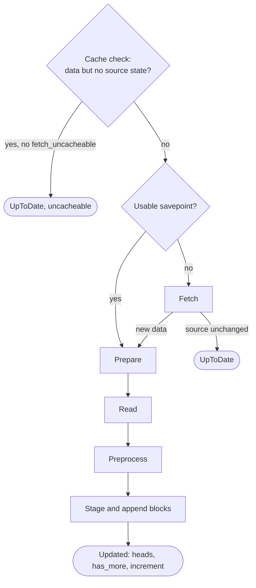

# Polling Ingest — Architecture

> **Status:** in production; covers polling ingest into root datasets through `SetPollingSource`.
> Behaviour that surprises newcomers is listed in [§12](#12-testing--gotchas).
> Type names and paths below are drawn from source — when they drift, treat the source as canonical
> and update this page.

---

## Agent / newcomer quick-start

**At a glance.**

- Kamu fetches data for a root dataset that declares a `SetPollingSource`: `kamu pull` drives it on
  the CLI, an ingest flow on the server.
- A run plans in a short transaction, then fetches, prepares and hands the file to the shared read,
  preprocess and write steps ([ingest-data-writer.md](ingest-data-writer.md)) with no transaction
  open; the caller commits `HEAD` afterwards.
- The **source state** stored in `AddData` (an ETag, a last-modified time, a last file name, a block
  number) lets the next run resume, and a local **savepoint** lets a failed run retry without
  fetching again.
- A source that yields data in batches reports `has_more`; who loops depends on the driver.

**Where to start reading, by intent:**

| You want to… | Start at |
| --- | --- |
| Follow a polling ingest end to end | [§4 Call sequence](#4-call-sequence) |
| Know what each fetch step stores and resumes from | [§5 Fetch steps](#5-fetch-steps) |
| Understand why a run did not fetch again | [§6 Savepoints](#6-savepoints) |
| See which entry point does what | [§8 Entry points](#8-entry-points) |
| Know how failures map to task outcomes | [§10 Errors](#10-errors) |
| Understand how records are merged and written | [ingest-data-writer.md](ingest-data-writer.md) |
| Find the file for X | [§13 Reference map](#13-filecrate-reference-map) |

---

## 1. Purpose & scope

This page covers the path from a polling source definition to a new `HEAD` of a root dataset: the
polling planner and service, the fetch and prepare layers, source state and savepoints, and the
entry points that drive them.

Out of scope, each with its own owner:

| Topic | Owner |
| --- | --- |
| Read, preprocess, merge strategies and the data writer | [ingest-data-writer.md](ingest-data-writer.md) |
| Push sources, where a client sends the data | [push-ingest.md](push-ingest.md) |
| When an ingest flow runs: schedules, retries, batching, `fetch_next_iteration` | [flow-system.md](flow-system.md) |
| How `kamu pull` plans, orders and authorizes ingest jobs among others | [dataset-pull.md](dataset-pull.md) |
| How the update task is queued, planned and run | [task-system.md](task-system.md) |
| How `DatasetReferenceMessage` and other outbox messages are delivered | [outbox.md](outbox.md) |

---

## 2. ODF concepts

| Topic | Spec / RFC |
| --- | --- |
| `SetPollingSource` | [Polling Sources](https://github.com/open-data-fabric/open-data-fabric/blob/master/specs/datasets/ingestion.md#push-and-polling-sources) |
| `DisablePollingSource` | [RFC-011](https://github.com/open-data-fabric/open-data-fabric/blob/master/rfcs/011-push-ingest-sources.md) |
| `AddData.newSourceState` | [RFC-009](https://github.com/open-data-fabric/open-data-fabric/blob/master/rfcs/009-ingest-source-state.md) |

The concepts the writer builds on are listed in
[ingest-data-writer.md](ingest-data-writer.md#2-odf-concepts).

---

## 3. Layers and crates

| Layer | Crate / path | Contents |
| --- | --- | --- |
| Domain interfaces | `kamu-core` — [`src/domain/core/src/services/ingest/`](../../src/domain/core/src/services/ingest) | `PollingIngestPlanner`, `PollingIngestService`, polling error types |
| Use case | `kamu-core` — `pull_dataset_use_case.rs` | `PullDatasetUseCase` |
| Services | `kamu` — [`src/infra/core/src/services/ingest/`](../../src/infra/core/src/services/ingest) | `PollingIngestPlannerImpl`, `PollingIngestServiceImpl`, `FetchService`, `PrepService` |
| Use case impl | `kamu` — [`src/infra/core/src/use_cases/`](../../src/infra/core/src/use_cases) | `PullDatasetUseCaseImpl` |
| Task adapter | `kamu-adapter-task-dataset` | `UpdateDatasetTaskPlanner`, `UpdateDatasetTaskRunner` |
| Flow adapter | `kamu-adapter-flow-dataset` | `FlowControllerIngest`, `FlowConfigRuleIngest` |
| Entry points | `kamu-cli` (`kamu pull`), the ingest flow | See [§8](#8-entry-points) |

---

## 4. Call sequence

A polling ingest has three steps, the same for every caller:

| Step | Who | Transaction |
| --- | --- | --- |
| **Plan** | `PollingIngestPlanner::plan_ingest(target)` builds the writer state at the current head into a `PollingIngestPlan`; `resolve_env_vars(dataset_id)` resolves the dataset's environment variables | one of its own, then the target is detached; `kamu pull` and the update task both plan through `DatasetUpdateSteps::plan_ingest` |
| **Execute** | `PollingIngestService::ingest(target, plan, options, env_vars, operation_id, listener)` runs one iteration and appends blocks without moving `HEAD` | none |
| **Commit** | the caller moves `HEAD` through `DatasetHeadCommitter` ([§9](#9-committing-and-concurrency)) | a new one |

Planning fails with `SourceNotDefined` when the dataset has no `SetPollingSource`.
`PollingIngestPlanPayload` is the plan's stored form, for a caller that stores a plan before
running it (only tests do). It records the expected head and what planning found there, never the
writer state itself. `rebuild_ingest` turns it back into a plan, failing with `HeadMoved` when the
head is no longer the expected one and with `Mismatch` when what it finds differs, which only a
defect can cause.

Environment variable values are never part of a plan or a task definition. `resolve_env_vars` is
their only path: it returns an empty map unless secrets encryption is configured and enabled
(`SecretsEncryptionConfig::is_enabled`) and a `DatasetEnvVarResolver` is registered, and
`IngestEnvVars` prints keys only.

`PollingIngestServiceImpl::ingest` runs one **iteration**:

1. **Cache check.** A source is *uncacheable* when the dataset already has data
   (`prev_offset.is_some()`) but no source state, and the fetch step is not MQTT. Without
   `fetch_uncacheable` such a source is skipped as `UpToDate { uncacheable: true }`.
2. **Fetch** ([§5](#5-fetch-steps)), honoring a savepoint ([§6](#6-savepoints)).
   `FetchResult::UpToDate` ends the iteration.
3. **Prepare** — optional `decompress` / `pipe` steps run on a blocking thread by `PrepService`,
   writing a new file into the cache directory.
4. **Read and preprocess** the prepared file
   ([ingest-data-writer.md](ingest-data-writer.md#4-read-and-preprocess)).
5. **Stage and commit** through the writer with the fetch's new source state and event time; event
   time missing from the input is the time the fetch step reported, otherwise system time.
6. Return `Updated` with both heads, `has_more`, the `increment` between the heads (blocks,
   records, watermark) and the advanced writer state, so a caller that loops need not plan again.

A failed iteration keeps its working directory, whose errors may point at logs in it
([ingest-data-writer.md](ingest-data-writer.md#9-local-files)). The service never moves `HEAD`; see
[§9](#9-committing-and-concurrency).

---

## 5. Fetch steps

`FetchService::fetch` dispatches on `FetchStep`. URL, headers, the container image, args and env
values, the MQTT password and the EVM node URL pass through `${{ env.NAME || default }}` templating.
A name that is not set falls through to the next option; a lookup that fails, such as a secret that
cannot be decrypted, fails the fetch. A substituted value is inserted as it is: a template inside
it is not expanded. With secrets encryption enabled (`DatasetKeyValueServiceImpl`), names resolve
from the dataset's env vars only; without it (`DatasetKeyValueServiceSysEnv`), any supplied dataset
env vars are checked first and the process environment is the fallback, which in practice means the
process environment, since `resolve_env_vars` supplies none in that mode.

| Fetch step | Source state written | `has_more` | Notes |
| --- | --- | --- | --- |
| `Url` `file://` | `LastModified` (file mtime) | never | Zero-copy: the original file is read in place ([§6](#6-savepoints)) |
| `Url` `http(s)://` | `ETag` or `LastModified` from response headers, else none | never | Sends `If-None-Match` / `If-Modified-Since`; `304` is up to date; a `Last-Modified` that does not parse is ignored |
| `Url` `ftp(s)://` | none | never | Uncacheable after the first ingest; behind the `ingest-ftp` feature |
| `FilesGlob` | `ETag` = name of the file just ingested | when more files sort after it | One file per iteration, ordered by name; event time from system time or the file path |
| `Container` | whatever the container writes to `ODF_NEW_ETAG_PATH` / `ODF_NEW_LAST_MODIFIED_PATH` | when it creates `ODF_NEW_HAS_MORE_DATA_PATH` | Receives `ODF_ETAG`, `ODF_LAST_MODIFIED`, `ODF_BATCH_SIZE`; same state as before means up to date |
| `Mqtt` | none | never | Always fetched; never treated as uncacheable and savepoints are ignored; behind `ingest-mqtt` |
| `EthereumLogs` | `ETag` encoding the last scanned block | when the scan stopped before the chain head | Behind `ingest-evm` |

`PollingSourceState` understands only the `odf/etag` and `odf/last-modified` kinds; any other kind
is ignored by the fetch step, which then fetches as if there were no previous state. The source
state is read from the latest `AddData` only, so any `AddData` written without one (for example by
a push ingest into the same dataset, [push-ingest.md](push-ingest.md)) makes the source look
stateless as well. The `cache` (`SourceCaching`) field of `Url` and `FilesGlob` fetch steps is not
consulted.

---

## 6. Savepoints

Fetching can be slow and expensive, while reading and merging can fail for reasons the user fixes
by editing the source (a bad preprocess query, a schema mismatch). After a successful fetch the
service writes a `FetchSavepoint` — creation time, new source state, event time, a reference to the
fetched data, `has_more` — to `cache/fetch-savepoint-<hash>`, where the hash covers the dataset
ID and the flatbuffers form of the fetch step and the previous source state. The next iteration of
the same dataset with the same fetch step and the same committed state resumes from the savepoint
instead of fetching again; datasets with identical fetch steps never share savepoints.

- A savepoint is ignored when the dataset has no source state and `fetch_uncacheable` is set, and
  always for MQTT.
- Zero-copy fetches (`file://`, `FilesGlob`) keep no savepoint: fetching again costs nothing, and
  resuming would pair the source state recorded then with whatever the file holds now, so a fixed
  file would be ingested a second time on the next poll.
- A savepoint is also ignored when its downloaded data was deleted from the cache, since resuming
  would commit its source state without the data, and when it does not parse. The source is
  fetched again in both cases.
- A savepoint is written to a temporary file and renamed into place, so a failed write leaves no
  truncated savepoint.
- Changing the fetch step or committing a new source state changes the hash, so stale savepoints
  are never matched — they are left behind and removed by cache eviction ([§11](#11-local-files)).
- Prepared files are deleted after staging; the fetched file and savepoint are kept on purpose so a
  user iterating on a broken source can re-run without re-downloading.

---

## 7. Iterating: `has_more`

A source that yields data in batches (glob, container, EVM) reports `has_more`. Who loops:

| Driver | Behaviour |
| --- | --- |
| `kamu pull` | repeats iterations until `has_more` is false ([dataset-pull.md](dataset-pull.md#62-per-job-runners)) |
| Ingest flow | one iteration per task; on success with `has_more` and `fetch_next_iteration` in the flow's ingest config, `FlowControllerIngest` schedules the next flow immediately |

---

## 8. Entry points

| Entry point | Path | Authorization | Transaction scope | Moves `HEAD` | Messages |
| --- | --- | --- | --- | --- | --- |
| `kamu pull <root>` | `PullCommand` → `PullDatasetUseCaseImpl` → `PullIngestLoop` → `PollingIngestService` | Write, per pull iteration ([dataset-pull.md](dataset-pull.md#7-authorization)) | pull planning in its own; then [§4](#4-call-sequence) per ingest iteration | after each iteration | `DatasetReferenceMessage` from the ref update |
| Ingest flow | `FlowControllerIngest` → `LogicalPlanDatasetUpdate` → `UpdateDatasetTaskPlanner` → `UpdateDatasetTaskRunner` → `PollingIngestService` (one iteration) | none; the task runs as `Principal::Node` | [§4](#4-call-sequence), when the task runs | once | `DatasetReferenceMessage`; task and flow progress messages |

Flow-side options reach ingest through `FlowConfigRuleIngest`: `fetch_uncacheable` becomes
`PollingIngestOptions::fetch_uncacheable`; `fetch_next_iteration` is read by the flow controller
only. Dataset env vars are resolved by the planner in both paths ([§4](#4-call-sequence)).

---

## 9. Committing and concurrency

The writer appends blocks without moving `HEAD`; the caller then moves it with a CAS. The shared
rules — the committer, the messages it posts, what a lost race leaves behind — are in
[dataset-operations.md](dataset-operations.md#3-committing-head). Specific to polling:

- The writer state is planned just before the fetch, for both `kamu pull` and the update task. A
  push that lands while the fetch runs makes the poll's CAS fail.
- The blocks published together can be a `SetDataSchema` alone, when a first ingest yields no rows
  ([ingest-data-writer.md](ingest-data-writer.md#6-what-stage-decides)).

---

## 10. Errors

Polling shares the input, engine and commit errors with push
([ingest-data-writer.md](ingest-data-writer.md#8-errors)); only polling has fetch, provisioning,
template and parameter errors.

Each error type says whether a retry could succeed: `PollingIngestError::is_recoverable` and
`PollingIngestPlanError::is_recoverable`, built on the same methods of `EngineError` and
`EngineProvisioningError`. Errors caused by the source definition or by the fetched data are not
recoverable, because a retry resumes from the same savepoint and fails the same way: template and
parameter errors, an invalid fetch step (`InvalidFetchStep`), read, schema, merge, execution and
validation errors, an invalid preprocess query, an unsupported engine, and a dataset without a
polling source. Fetch, process, image, commit and internal errors are recoverable. The update task
maps the flag, and the failures to move `HEAD`, to its outcome
([task-system.md](task-system.md#71-update-dataset)).

A retry after another writer moved `HEAD` plans from the new head. It reuses the fetch savepoint
only if the winning commit left the source state unchanged, as `set-watermark` does; if the winner
was a push, which writes no source state, the source now looks uncacheable and the retry is
skipped as up to date unless `fetch_uncacheable` is set.

---

## 11. Local files

| Directory | Holds | Cleaned |
| --- | --- | --- |
| `RunInfoDir/fetch-<operation_id>/`, `RunInfoDir/raw-query-<operation_id>/` | container fetch output and logs; preprocess engine I/O and logs | cleared when the process starts |
| `CacheDir/fetch-*`, `prepare-*` | fetched and prepared input | prepared files after staging, or when reading or preprocessing fails; a fetch target no savepoint refers to (failed, up-to-date or zero-copy fetch) right away; other fetched files by eviction |
| `CacheDir/fetch-savepoint-<hash>` | savepoints | by eviction |

The operation directory the writer stages into is owned by
[ingest-data-writer.md](ingest-data-writer.md#9-local-files).

Eviction (`GcService::evict_cache`) runs at process start and removes cache entries older than 24
hours. A long-running server does not evict while it runs.

---

## 12. Testing & gotchas

### Testing

- Fetch, prepare, polling planner and polling service tests live in
  `src/infra/core/tests/tests/ingest/`; CLI scenarios in
  `src/e2e/app/cli/repo-tests/src/commands/test_pull_command.rs`, wired for SQLite only when they
  check only CLI output.
- Server-side ingest flows run end to end in `src/e2e/app/cli/repo-tests/src/test_flow.rs` on SQLite
  and Postgres: env vars from a `VariableSet`, failure without and with retries,
  `fetchNextIteration`, and a manual trigger forcing `fetchUncacheable`. With the system time
  frozen, a follow-up flow waits out its throttling period only when the test advances the time.
- The pull loop (`exhaust_sources`, `IngestStopped`, head moved) is tested in
  `test_pull_dataset_use_case.rs`; the update task runner in
  `src/adapter/task-dataset/tests/`, including a real planner and service over a `file://` source
  (`BaseRepoHarness::create_root_dataset_polling_csv`).
- `MockPollingIngestService` (helpers in `src/domain/core/src/testing/mock_polling_ingest_service.rs`)
  stands in for the polling service where a test needs no fetching;
  `make_expect_ingest_iterations` reports a sequence of `MockIngestIteration`s.
- Zero-copy sources keep no savepoints ([§6](#6-savepoints)), so tests of downloaded data and
  savepoints serve files over HTTP in-process with `test_utils::HttpFileServer`, which sends
  `Last-Modified` but no `ETag`.
- Containerized fetch and preprocess tests need Podman or Docker and are grouped separately; see
  [`DEVELOPER.md`](../../DEVELOPER.md).
- Changing the flatbuffers form of `FetchStep` or `SourceState` invalidates every existing
  savepoint; that is harmless but forces a re-fetch.

### Behaviour by design

| Area | What happens |
| --- | --- |
| Uncacheable sources | A source with data but no source state is skipped as up to date unless `fetch_uncacheable` is set ([§4](#4-call-sequence)) |
| Savepoints after success | Fetched data and savepoints stay in the cache so a user can re-run a broken source without re-downloading |

---

## 13. File/crate reference map

| Concern | File |
| --- | --- |
| Polling planner trait, plan, env vars, planning errors | [`polling_ingest_planner.rs`](../../src/domain/core/src/services/ingest/polling_ingest_planner.rs) |
| Stored plan form | [`polling_ingest_plan_payload.rs`](../../src/domain/core/src/services/ingest/polling_ingest_plan_payload.rs) |
| Polling planner impl, env var gate | [`polling_ingest_planner_impl.rs`](../../src/infra/core/src/services/ingest/polling_ingest_planner_impl.rs) |
| Polling service trait, options, result, errors | [`polling_ingest_service.rs`](../../src/domain/core/src/services/ingest/polling_ingest_service.rs) |
| Polling service impl, savepoints | [`polling_ingest_service_impl.rs`](../../src/infra/core/src/services/ingest/polling_ingest_service_impl.rs) |
| Source state and savepoint types | [`polling_source_state.rs`](../../src/infra/core/src/services/ingest/polling_source_state.rs) |
| Fetch dispatch and templating | [`fetch_service/core.rs`](../../src/infra/core/src/services/ingest/fetch_service/core.rs), [`template.rs`](../../src/infra/core/src/services/ingest/fetch_service/template.rs) |
| Fetch step impls | [`fetch_service/`](../../src/infra/core/src/services/ingest/fetch_service) (`file.rs`, `http.rs`, `ftp.rs`, `container.rs`, `mqtt.rs`, `evm.rs`) |
| Prepare steps | [`prep_service.rs`](../../src/infra/core/src/services/ingest/prep_service.rs) |
| Pull use case | [`pull_dataset_use_case_impl.rs`](../../src/infra/core/src/use_cases/pull_dataset_use_case_impl.rs) |
| Pull polling loop, ref update | [`pull_ingest_loop.rs`](../../src/infra/core/src/use_cases/pull_ingest_loop.rs) |
| Update task planner / runner | [`update_dataset_task_planner.rs`](../../src/adapter/task-dataset/src/planners/update_dataset_task_planner.rs), [`update_dataset_task_runner.rs`](../../src/adapter/task-dataset/src/runners/update_dataset_task_runner.rs) |
| Ingest flow controller | [`flow_controller_ingest.rs`](../../src/adapter/flow-dataset/src/flow_controllers/flow_controller_ingest.rs) |
| CLI command | [`pull_command.rs`](../../src/app/cli/src/commands/pull_command.rs) |
