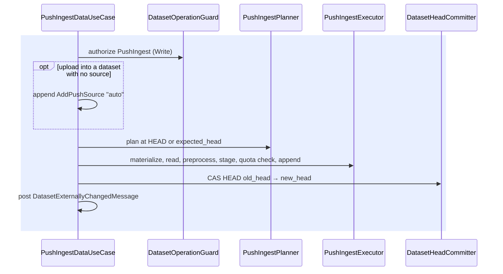

# Push Ingest — Architecture

> **Status:** in production; covers push ingest into root datasets through `AddPushSource`.
> Behaviour that surprises newcomers is listed in [§10](#10-testing--gotchas).
> Type names and paths below are drawn from source — when they drift, treat the source as canonical
> and update this page.

---

## Agent / newcomer quick-start

**At a glance.**

- A client sends data into a root dataset that declares one or more named `AddPushSource` events:
  `kamu ingest`, the `POST /{dataset}/ingest` endpoint, or an in-process use case such as
  collections.
- Everything runs in one transaction, the command's or the request's: authorize, plan, execute,
  move `HEAD`.
- Execution materializes the input into a file and hands it to the shared read, preprocess and
  write steps ([ingest-data-writer.md](ingest-data-writer.md)), with a storage quota check between
  staging and appending.
- Push stores no source state, and only an upload creates a push source on the fly.

**Where to start reading, by intent:**

| You want to… | Start at |
| --- | --- |
| Follow a push ingest end to end | [§4 Call sequence](#4-call-sequence) |
| Know what input a push accepts | [§5 Data sources and formats](#5-data-sources-and-formats) |
| See which entry point does what | [§6 Entry points](#6-entry-points) |
| Know how failures map to status codes | [§8 Errors](#8-errors) |
| Understand how records are merged and written | [ingest-data-writer.md](ingest-data-writer.md) |
| Find the file for X | [§11 Reference map](#11-filecrate-reference-map) |

---

## 1. Purpose & scope

This page covers the path from data sent by a client to a new `HEAD` of a root dataset: the push
use case, the push planner and executor, the input forms and formats, and the entry points that
drive them.

Out of scope, each with its own owner:

| Topic | Owner |
| --- | --- |
| Read, preprocess, merge strategies and the data writer | [ingest-data-writer.md](ingest-data-writer.md) |
| Polling sources, which Kamu fetches itself | [polling-ingest.md](polling-ingest.md) |
| The shared rules for moving `HEAD` and lost races | [dataset-operations.md](dataset-operations.md#3-committing-head) |
| How `DatasetReferenceMessage` and other outbox messages are delivered | [outbox.md](outbox.md) |

---

## 2. ODF concepts

| Topic | Spec / RFC |
| --- | --- |
| `AddPushSource`, `DisablePushSource` | [RFC-011](https://github.com/open-data-fabric/open-data-fabric/blob/master/rfcs/011-push-ingest-sources.md) |

The concepts the writer builds on are listed in
[ingest-data-writer.md](ingest-data-writer.md#2-odf-concepts).

---

## 3. Layers and crates

| Layer | Crate / path | Contents |
| --- | --- | --- |
| Domain interfaces | `kamu-core` — [`src/domain/core/src/services/ingest/`](../../src/domain/core/src/services/ingest) | `PushIngestPlanner`, `PushIngestExecutor`, push error types |
| Use case | `kamu-core` — [`push_ingest_data_use_case.rs`](../../src/domain/core/src/use_cases/push_ingest_data_use_case.rs) | `PushIngestDataUseCase` |
| Services | `kamu` — [`src/infra/core/src/services/ingest/`](../../src/infra/core/src/services/ingest) | `PushIngestPlannerImpl`, `PushIngestExecutorImpl`, `DataFormatRegistryImpl` |
| Use case impl | `kamu` — [`src/infra/core/src/use_cases/`](../../src/infra/core/src/use_cases) | `PushIngestDataUseCaseImpl` |
| Entry points | `kamu-cli` (`kamu ingest`), `kamu-adapter-http` (`POST /{dataset}/ingest`) | See [§6](#6-entry-points) |

---

## 4. Call sequence

Push ingest runs in one transaction, the command's or the request's:

`PushIngestDataUseCaseImpl::execute(target, data_source, options, listener)` first authorizes
`PushIngest` (Write) on the target for the current `Principal` through
[`DatasetOperationGuard`](../../src/domain/datasets/domain/src/services/dataset_operation_guard.rs),
before anything is read; a denial on a readable dataset is `PushIngestDataError::Access`, a missing
or unreadable dataset `NotFound`.
Then:

1. **Add a push source** (uploads through the HTTP endpoint only) —
   `PushIngestPlannerImpl::plan_push_source_creation` returns an
   `AddPushSource { source_name: "auto", merge: Append }`, with a read step guessed from the media
   type, when the dataset has no source at all. The use case appends it on top of `expected_head`
   when given, or of `HEAD` as it is then, without moving `HEAD`; the data is then planned on top
   of the new source block. Step 4 publishes the source block with the data, or alone when the
   upload adds nothing, so the result is `Updated` either way and counts the source block. A
   failed ingest leaves the source block unreferenced. Without a media type the push fails with
   `SourceNotFound`.
2. **Plan** — a derived dataset is rejected with `InvalidDatasetKind`.
   `PushIngestPlannerImpl::plan_ingest` builds the writer state at `HEAD` (or at
   `expected_head` when given) for `source_name`. The planner writes nothing. A missing source is
   `SourceNotFound`; with no `source_name` and several push sources, `WriterSourceEventVisitor`
   reports the ambiguity as `SourceNotFound` too.
3. **Execute** — `PushIngestExecutorImpl::execute_ingest`:
   materialize the `DataSource` into a file (a `file://` URL is used in place unless it is a FIFO
   or device, which is copied first; buffers and streams are written to the operation directory),
   read and preprocess it ([ingest-data-writer.md](ingest-data-writer.md#4-read-and-preprocess)),
   `stage`, check the account storage quota on the staged file size unless `skip_quota_check`
   (always skipped in single-tenant workspaces), then `commit`. Event time missing from the input
   is the caller's event time, otherwise system time.
4. **Finalize** — move `HEAD` from `old_head` to `new_head` through `DatasetHeadCommitter` and post
   `DatasetExternallyChangedMessage::ingest_http`.

The executor reports `begin` and progress to the listener; the use case reports `success` or `error`
once, after step 4 or the failure ([dataset-pull.md](dataset-pull.md#63-listeners)).

`execute_multi` runs steps 1 to 3 for each data source in turn, threading the new head through
`expected_head`, and moves `HEAD` once at the end from the first `old_head` to the last `new_head`.
The account statistics count only data reachable from the committed `HEAD`, so each quota check
adds the sizes of the files ingested earlier in the same call (`uncommitted_bytes`).

Push ingest stores no source state (`new_source_state: None`), so `AddPushSource`'s capacity for
exactly-once resume is unused.

---

## 5. Data sources and formats

| `DataSource` | Produced by |
| --- | --- |
| `Url` (`file://` only) | `kamu ingest <files>`, `kamu ingest --stdin` (as `/dev/fd/0`) |
| `Stream` | HTTP request body, or the upload store stream for an `uploadToken` |
| `Buffer` | in-process callers such as collections and versioned files |

`DataFormatRegistryImpl` maps media types and file extensions to `ReadStep`s:
`get_best_effort_config` builds a read step from a media type alone (used to auto-create a source),
and `get_compatible_read_config` returns the existing read step unchanged when its format matches
the media type, and otherwise builds a best-effort one for the media type that keeps only the
schema.

---

## 6. Entry points

| Entry point | Path | Authorization | Transaction scope | Moves `HEAD` | Messages |
| --- | --- | --- | --- | --- | --- |
| `kamu ingest <root>` | `IngestCommand` → `PushIngestDataUseCase::execute` per file | Write, in the use case; the command rejects derivative datasets and datasets with a pull alias | the command's | once per file | `DatasetReferenceMessage`, `DatasetExternallyChangedMessage` |
| `POST /{dataset}/ingest` | `dataset_ingest_handler` → `PushIngestDataUseCase::execute` | Write, in the use case; upload token must belong to the caller | the whole request (`#[transactional_handler]`) | once | as above |
| Collections, versioned files | `UpdateCollectionEntriesUseCaseImpl`, `UpdateVersionedFileUseCaseImpl` → `PushIngestDataUseCase` | the calling use case, then Write again in the push ingest use case | the caller's | once | as above |

---

## 7. Committing and concurrency

The writer appends blocks without moving `HEAD`; the use case then moves it with a CAS. The shared
rules are in [dataset-operations.md](dataset-operations.md#3-committing-head). Specific to push:

- A lost CAS in step 4 is `PushIngestDataError::Execution` wrapping
  `CommitError::MetadataAppendError(AppendError::RefCASFailed)` with the expected and actual heads;
  `HEAD` stays where the winner put it and the appended blocks stay unreferenced.
- The blocks published together can be an auto-created push source alone, when an upload adds no
  rows ([§4](#4-call-sequence)).
- Push ingest posts `DatasetExternallyChangedMessage` besides the reference message.
- A push writes no source state, so a polling source in the same dataset looks stateless after it
  ([polling-ingest.md](polling-ingest.md#5-fetch-steps)).

---

## 8. Errors

Push shares the input, engine and commit errors with polling
([ingest-data-writer.md](ingest-data-writer.md#8-errors)); only push has the media type, quota and
access errors. Push planning fails separately with `PushIngestPlanningError`.

The HTTP handler maps push errors to status codes: `SourceNotFound`, `InvalidDatasetKind`, a
`Content-Type` header that is not visible ASCII, and the input errors other than `MergeError` →
400, unsupported media type → 415, an exceeded quota → 403, `NotFound` and `Access` → 404 (a
dataset the caller may not write looks missing), a `HEAD` CAS conflict → 409, the rest → 500.

---

## 9. Local files

Input copies (a FIFO or device, a buffer, a stream) are written to
`RunInfoDir/ingest-<operation_id>/`, the same directory the writer stages into; its cleanup is owned by
[ingest-data-writer.md](ingest-data-writer.md#9-local-files).

---

## 10. Testing & gotchas

### Testing

- Push service tests live in `src/infra/core/tests/tests/ingest/test_push_ingest.rs`; CLI scenarios
  in `src/e2e/app/cli/repo-tests/src/commands/test_ingest_command.rs`, wired for SQLite only when
  they check only CLI output.

### Behaviour by design

| Area | What happens |
| --- | --- |
| Push source state | Push ingest writes no source state |
| Auto-created push source | Only an upload-token push creates one; a raw-body push or `kamu ingest` into a dataset without a push source fails with `SourceNotFound` |

---

## 11. File/crate reference map

| Concern | File |
| --- | --- |
| Push planner / executor traits | [`push_ingest_planner.rs`](../../src/domain/core/src/services/ingest/push_ingest_planner.rs), [`push_ingest_executor.rs`](../../src/domain/core/src/services/ingest/push_ingest_executor.rs) |
| Push planner / executor impls | [`push_ingest_planner_impl.rs`](../../src/infra/core/src/services/ingest/push_ingest_planner_impl.rs), [`push_ingest_executor_impl.rs`](../../src/infra/core/src/services/ingest/push_ingest_executor_impl.rs) |
| Push use case | [`push_ingest_data_use_case_impl.rs`](../../src/infra/core/src/use_cases/push_ingest_data_use_case_impl.rs) |
| Format registry | [`data_format_registry_impl.rs`](../../src/infra/core/src/services/ingest/data_format_registry_impl.rs) |
| HTTP push endpoint | [`ingest_handler.rs`](../../src/adapter/http/src/data/ingest_handler.rs) |
| CLI command | [`ingest_command.rs`](../../src/app/cli/src/commands/ingest_command.rs) |
